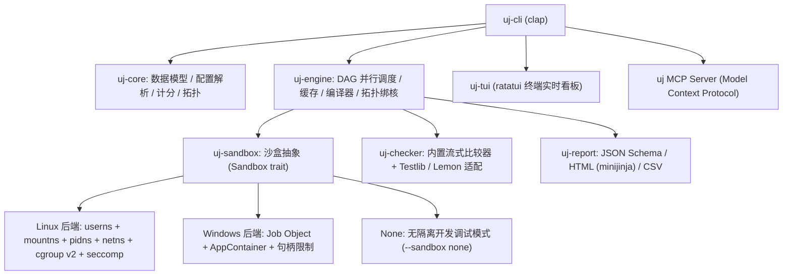

# uj (Universal Judge)

<p align="center">
  <strong>现代化、高性能、跨平台的算法竞赛本地判题与出题套件</strong>
  <br>
  <em>针对 AI 出题 Agent 与人类命题团队量身打造</em>
</p>

---

## 🌟 核心特性

- ⚡ **极致性能与低开销**：基于 Rust（Edition 2024）构建，无运行时沉重依赖；冷启动耗时 `< 50 ms`，Linux 单次沙盒调度开销 `≤ 5 ms`，Windows `≤ 15 ms`。
- 🛡️ **健全的双平台原生沙盒**：
  - **Linux**：基于非 root 用户命名空间（`user`, `mount`, `pid`, `net`, `ipc`, `uts`）+ `cgroup v2`（精准计量 `memory.peak` 与 `cpu.stat`）+ `seccomp-bpf` 系统调用过滤（阻断 `x32` ABI 越界与特权调用）；在缺少 cgroup v2 时平滑降级至 `Tier::Degraded`（保留 namespace 与 seccomp 强隔离，辅以 POSIX rlimits 与 `getrusage` 计量）。
  - **Windows**：基于独占 `AppContainer` 安全隔离配置文件（严控文件 ACL，禁止访问外部答案与宿主文件）+ `Job Object`（精准计量 Commit 提交内存与 CPU 时间，物理 P 核绑核，句柄泄漏防御与 Defender 启动扫描阻滞自适应）。
- 🤖 **面向 AI Agent 的原生设计**：
  - 内置 **Model Context Protocol (MCP)** stdio 服务端，AI Agent 可通过标准协议自动完成初始化、数据生成、解法校验、时限校准与判题。
  - 纯粹的零标准输出污染设计：结构化日志全走 `stderr`，`stdout` 输出严格遵循 JSON Schema / NDJSON 规范。
- 🔄 **全生命周期出题流水线**：
  - `init` ➡️ `build` ➡️ `gen` ➡️ `validate` ➡️ `ans` ➡️ `verify` ➡️ `tl` ➡️ `pipeline` ➡️ `stress` 一站式自动化。
- ⚖️ **丰富的评测协议与题型支持**：
  - 支持 **传统题（Traditional）**、**交互题（Interactive）**、**通信题（Communication，多选手进程与 Manager 管道互联）** 与 **提交答案题（Output-only）**。
  - 内嵌零拷贝高速比较器（`exact`, `wcmp`, `fcmp`, `lcmp`, `rcmp`, `yesno`, `hcmp`, `ncmp`），原生兼容 **Testlib**（Checker, Validator, Interactor）与 **Lemon / LemonLime** 传统竞赛工程及子任务依赖。
- 📊 **可视化与专业报表**：
  - 支持交互式 **Ratatui TUI** 实时评测监视器。
  - 支持导出结构化 HTML 与 CSV 成绩单。

---

## 🏗️ 架构概览



### Workspace 组件划分

| Crate | 功能职责 |
|---|---|
| [`crates/uj-core`](file:///crates/uj-core) | 数据结构（`Verdict`, `RunSpec`, `RunResult`, `Limits`）、`problem.toml` / `languages.toml` 解析、计分规则与子任务 DAG 依赖。 |
| [`crates/uj-sandbox`](file:///crates/uj-sandbox) | 平台原生沙盒驱动（Linux userns/cgroup/seccomp, Windows JobObject/AppContainer, None）、匿名状态管道、环境健康探测（`doctor`）。 |
| [`crates/uj-engine`](file:///crates/uj-engine) | 调度引擎（纯线程池 + crossbeam，**零 tokio**）、多源编译与 Blake3 增量缓存、大小核感知拓扑（物理 P 核独占绑定）、测试运行循环。 |
| [`crates/uj-checker`](file:///crates/uj-checker) | 内置 mmap/memchr 高速比较器、Testlib（SPJ Checker/Interactor）适配协议、Lemon CDF 格式适配。 |
| [`crates/uj-report`](file:///crates/uj-report) | 报表生成器，支持 JSON Schema（schemars）、NDJSON 流式事件、HTML 离线报告与 CSV 汇总。 |
| [`crates/uj-tui`](file:///crates/uj-tui) | 基于 Ratatui 的多任务并发评测实时看板。 |
| [`crates/uj-cli`](file:///crates/uj-cli) | 命令行入口、子命令路由、stdio MCP Server、退出状态码映射与信号收敛。 |

---

## 🔒 安全与威胁模型

`uj` 旨在执行**不可信、具有潜在 Bug 或由 LLM 生成的代码**。

### 防御范围
1. **文件系统隔离**：被测程序运行在隔离的只读环境（Linux 为独立的 tmpfs 根目录与只读 bind mount，Windows 为只授权给当前 slot 的临时 box 目录）。严禁读取其他题目的标准输入输出答案，严禁篡改宿主机文件。
2. **网络隔离**：全面切断外部网络（Linux 独立的空网络命名空间，Windows AppContainer 禁用网络功能）。
3. **资源失控防护**：通过 CPU 时间（精确至微秒）、墙钟时间（防死锁）、内存（Windows 提交内存 / Linux 物理页峰值）、输出量（防止磁盘填满）与进程数（防 fork 炸弹）进行强力限制。
4. **宿主进程保护**：独立的 PID 命名空间，选手程序仅能看到容器内部，无法探测或向宿主进程发送信号。

### 不防御范围
- CPU 硬件级侧信道攻击（Spectre/Meltdown）。
- 宿主操作系统内核未修复的 0-day 漏洞。

---

## 🚀 快速上手

### 1. 编译安装

```bash
# 需已安装 Rust 1.85+ (Edition 2024)
git clone https://github.com/uj-cil/uj.git
cd uj
cargo build --release

# 二进制位于 target/release/uj
```

### 2. 环境健康检查

```bash
# 检查当前系统对沙盒、编译器、cgroup/JobObject 的支持状态
uj doctor
```

### 3. 题目创建与生命周期管理

```bash
# 1. 初始化标准传统题
uj init my_problem --type traditional
cd my_problem

# 2. 编写题目配置 (problem.toml)，生成测试数据
uj gen

# 3. 校验输入数据是否合法
uj validate

# 4. 生成标准参考答案 (.ans)
uj ans

# 5. 校验各种标程/部分分程序是否符合预期结论
uj verify

# 6. 一键全自动执行完整命题流水线
uj pipeline
```

### 4. 判题与对拍

```bash
# 评测单份选手源码（支持 C++、C、Python、Rust、Go 等）
uj judge solution.cpp

# 评测并启动 Ratatui 实时监控看板
uj judge solution.cpp --tui

# 多核对拍（随机生成器 + 待测解 + 暴力正解）
uj stress --gen gen.cpp --sol sol.cpp --brute brute.cpp -n 1000

# 模拟赛整包评测（Lemon / LemonLime 目录结构）
uj contest /path/to/contest_dir
```

### 5. 导出评测报告

```bash
# 生成最新评测记录的 HTML 报告与 CSV 报表
uj report --html report.html --csv results.csv
```

### 6. 作为 AI Agent 的 MCP Server 运行

在 Claude Desktop 或其它 Agent 客户端的配置中添加：

```json
{
  "mcpServers": {
    "uj": {
      "command": "uj",
      "args": ["mcp"]
    }
  }
}
```

---

## ⚙️ 配置文件示例 (`problem.toml`)

```toml
[problem]
id = "aplusb"
title = "A + B Problem"
type = "traditional" # traditional | interactive | communication | output-only

[limits]
time_ms = 1000       # CPU 时间上限 (ms)
wall_time_ms = 2000  # 墙钟时间上限 (ms)
memory_bytes = 268435456 # 256 MB
output_bytes = 10485760  # 10 MB

[io]
mode = "standard"    # standard (stdin/stdout) | file (指定 in_file/out_file)

[checker]
type = "builtin"
name = "wcmp"        # 过滤多余空白符比较

[[subtasks]]
id = 1
score = 40
pattern = "data/1-*.in"

[[subtasks]]
id = 2
score = 60
pattern = "data/2-*.in"
dependencies = [1]   # 依赖子任务 1

[[solutions]]
source = "solutions/ac.cpp"
expect = "AC"

[[solutions]]
source = "solutions/tle.cpp"
expect = "TLE"
```

---

## 💻 命令行常用选项

| 参数 | 说明 | 默认值 |
|---|---|---|
| `-j, --jobs <N>` | 并发评测槽位数 | 物理核心数 - 1 |
| `--sandbox <MODE>` | 沙盒隔离级别：`auto` \| `full` \| `degraded` \| `none` | `auto` |
| `--require-tier` | 严格要求 Full 沙盒，若不支持则直接报错中止 | `false` |
| `--fail-fast` | 遇到第一个未通过测试点时立即中止当前子任务 | `false` |
| `--tui` | 开启 Ratatui 交互式终端监控界面 | `false` |
| `--format <FMT>` | 报告输出格式：`human` \| `json` \| `ndjson` | TTY 环境为 human，否则为 json |
| `--no-cache` | 禁用编译结果与运行结果的 Blake3 缓存 | `false` |

---

## 📄 退出状态码规范

| 退出码 | 常量 | 语义说明 |
|---|---|---|
| `0` | `EXIT_SUCCESS` | 判题结论完全为 Accepted (AC)，或命令执行成功 |
| `1` | `EXIT_NON_AC` | 评测完成，但存在非 AC 测试点（WA, TLE, MLE, RE 等） |
| `2` | `EXIT_JUDGE_FAILED` | 裁判系统错误（编译失败、校验器崩溃、沙盒错误等） |
| `3` | `EXIT_USAGE_OR_CONFIG` | 命令行参数无效或题目配置文件损坏 |
| `130` | `EXIT_INTERRUPTED` | 用户主动通过 Ctrl+C 中断评测流程 |

---

## 📜 许可证

本项目采用 [MIT OR Apache-2.0](file:///LICENSE) 双重开源许可证授权。
