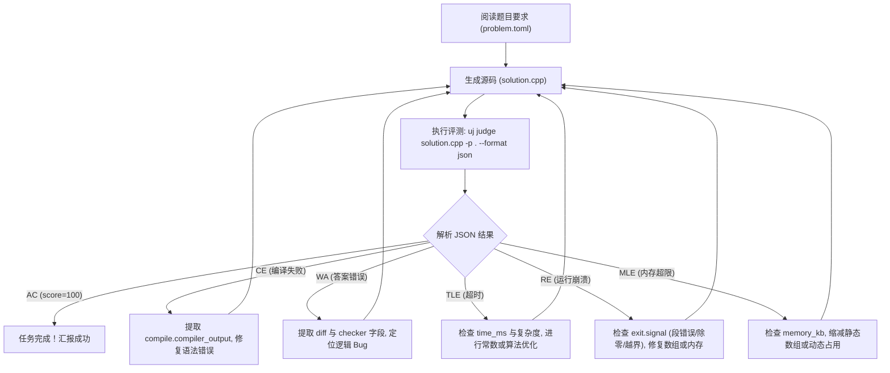

# uj AI Agent 详细使用与集成指南 (Agent Guide)

> 本文档面向与 `uj` 系统交互的 **AI 编程助手（AI Agents，如 Antigravity, Claude, Cursor, Copilot, 自主出题与解题智能体）**。
> 无论你是通过 **Model Context Protocol (MCP)** 还是通过 **CLI 命令行/子进程** 调度 `uj`，本文档都提供了完整的调用规范、交互范式、JSON 解析范式及经典出题/解题工作流（Recipes）。

---

## 1. Agent 视角下的交互定位与原则

`uj` 在设计之初就将 AI Agent 视为一等公民，具备以下关键特性：

1. **绝对标准输出（stdout）纯净度**：
   - 当指定 `--format json` 或 `--format ndjson` 时，标准输出（`stdout`）**绝不包含任何 ANSI 颜色代码、进度条、调试日志或警告文本**，只输出合法纯净的 JSON 协议载荷。
   - 所有调试告警（例如降级提示、编译输出、进度更新）一律写入 `stderr`。Agent 切勿使用 `2>&1` 将 stderr 混入 stdout，否则会破坏 JSON 反序列化。
2. **确定性退出状态码 (Exit Codes)**：
   - Agent 可根据进程退出码快速判定评测宏观结论：
     - `0` (`EXIT_SUCCESS`)：所有测试点均通过（AC），或命令执行成功。
     - `1` (`EXIT_NON_AC`)：评测完成，但存在测试点未通过（WA / TLE / MLE / RE / OLE）。
     - `2` (`EXIT_JUDGE_FAILED`)：评测系统异常（如编译失败 CE、校验器崩溃、沙盒报错）。
     - `3` (`EXIT_USAGE_OR_CONFIG`)：命令行参数错误或 `problem.toml` 语法非法。
     - `130` (`EXIT_INTERRUPTED`)：被 SIGINT / Ctrl-C 中断。
3. **机器可读的 JSON Schema 支持**：
   - 任何时刻均可运行 `uj schema result`、`uj schema config`、`uj schema events` 导出标准的 JSON Schema 定义文件，用于代码生成或类型约束校验。

---

## 2. 两种集成模式：MCP 还是 CLI？

### 2.1 模式 A：MCP (Model Context Protocol) 服务模式（推荐）

通过标准 stdio JSON-RPC 2.0 协议连接 `uj mcp`。LLM 可直接将其作为工具（Tools）调用。

#### 客户端配置示例 (Claude Desktop / Roo Code / Antigravity)
```json
{
  "mcpServers": {
    "uj": {
      "command": "uj",
      "args": ["mcp"]
    }
  }
}
```

#### MCP 对外暴露的核心工具列表 (Tool Call Catalog)

| 工具名称 (Tool Name) | 参数 (Arguments) | 适用场景 |
|---|---|---|
| `doctor` | `{ "problem": boolean }` | 诊断宿主沙盒与当前题目数据健康度 |
| `judge` | `{ "submission": "sol.cpp", "problem": "." }` | 评测单份选手源码并返回详细测试点指标 |
| `build` | `{ "problem": ".", "targets": [] }` | 编译题目下的所有组件（Checker、Validator、标程等） |
| `pipeline` | `{ "problem": "." }` | 一键执行自动化出题流水线（build ➡️ gen ➡️ val ➡️ ans ➡️ verify ➡️ tl） |
| `stress` | `{ "generator": "gen.cpp", "solution": "sol.cpp", "brute": "brute.cpp", "count": 100 }` | 自动化对拍找反例 |
| `verify` | `{ "problem": "." }` | 批量验证 `problem.toml` 中声明的所有期望解法 |
| `show` | `{ "problem": ".", "run_id": "", "test": "1-01" }` | 深度检查某次运行或某个具体测试点的输入输出差异 |
| `contest` | `{ "dir": "contest_root" }` | 批量评测整场多题多选手的比赛包 |

---

### 2.2 模式 B：CLI 子进程执行模式

若在终端或通过代码子进程（`subprocess` / `Command`）直接调用，必须附加 `--format json` 标识以获取结构化数据：

```bash
# 评测单个解法并输出纯 JSON
uj judge solution.cpp -p . --format json

# 评测多个解法并开启 fail-fast（遇到首个错点立即停机）
uj judge sol1.cpp sol2.py -p . --format json --fail-fast

# 限制并发槽位（例如在 CI 或共享容器中）
uj judge solution.cpp -p . -j 4 --format json
```

---

## 3. Agent 核心任务实战工作流 (Action Recipes)

### 场景一：解题 Agent（自动编写代码、调试并提交）

当 Agent 的任务是针对某道题编写代码并确保 Accepted 时，标准循环流程如下：



#### JSON 结果解析范式 (Python 示例)
```python
import json
import subprocess

def evaluate_code(solution_path: str, problem_dir: str = "."):
    cmd = ["uj", "judge", solution_path, "-p", problem_dir, "--format", "json"]
    proc = subprocess.run(cmd, stdout=subprocess.PIPE, stderr=subprocess.PIPE, text=True)
    
    # 纯净的 stdout 直接转为 JSON
    report = json.loads(proc.stdout)
    
    # 1. 检查编译状态
    if not report.get("compile", {}).get("success", False):
        compiler_err = report["compile"]["compiler_output"]
        return {"status": "CE", "detail": compiler_err}
        
    verdict = report["verdict"]
    score = report["score"]
    
    # 2. 如果非 AC，找出第一个未通过的测试点
    if verdict != "AC":
        failed_tests = []
        for sub in report.get("subtasks", []):
            for t in sub.get("tests", []):
                if t["verdict"] != "AC":
                    failed_tests.append({
                        "test_id": t["id"],
                        "subtask": sub["id"],
                        "verdict": t["verdict"],
                        "time_ms": t["time_ms"],
                        "memory_kb": t["memory_kb"],
                        "checker_msg": t.get("checker"),
                        "diff": t.get("diff"),
                        "signal": t.get("exit", {}).get("signal")
                    })
        return {"status": verdict, "score": score, "failures": failed_tests}
        
    return {"status": "AC", "score": score}
```

---

### 场景二：出题 Agent（从零自动化命制全新题目）

当 Agent 负责自动化命题时，建议按顺序执行以下原子操作：

#### 步骤 1：初始化骨架
```bash
# 生成标准化目录结构与默认 problem.toml
uj init my_problem --type traditional
cd my_problem
```

生成的标准目录布局：
```
my_problem/
├── problem.toml           # 核心元数据、时空限制、子任务与分值
├── problem.md             # 题面描述文件
├── checker.cpp            # 自定义 SPJ 比较器 (可选, 默认可使用内置 wcmp/exact)
├── validator.cpp          # 输入合法性验证器 (testlib 规范)
├── solutions/             # 解法矩阵
│   ├── ac.cpp             # 官方标程 (tag: AC)
│   ├── tle.cpp            # 暴力未优化解 (tag: TLE)
│   └── wa.cpp             # 贪心错误解 (tag: WA)
├── generators/            # 随机或极端数据生成器
│   └── gen.cpp
└── data/                  # 最终生成的测试数据 (.in / .ans)
```

#### 步骤 2：配置 `problem.toml`
Agent 生成清晰的配置，例如带子任务依赖的题目：
```toml
[problem]
id = "interval_sum"
title = "区间和查询"
type = "traditional"

[limits]
time_ms = 1000
memory_bytes = 268435456 # 256 MB

[checker]
type = "builtin"
name = "wcmp"

[[tests.gen]]
generator = "generators/gen.cpp"
args = ["--n", "1000", "--q", "1000", "--seed", "42"]
output = "data/1-01.in"

[[subtasks]]
id = 1
score = 30
pattern = "data/1-*.in"

[[subtasks]]
id = 2
score = 70
pattern = "data/2-*.in"
dependencies = [1] # 依赖子任务 1

[[solutions]]
source = "solutions/ac.cpp"
expect = "AC"

[[solutions]]
source = "solutions/brute.cpp"
expect = "TLE"
```

#### 步骤 3：一键出题流水线 (`uj pipeline`)
出题 Agent 只需发起一条命令：
```bash
uj pipeline -p . --format json
```
流水线将在内部全自动并行完成以下操作：
1. **Build**：并发编译生成器 `gen.cpp`、验证器 `validator.cpp`、比较器与所有解法。
2. **Gen**：执行 `[[tests.gen]]` 脚本批量生成 `.in` 输入文件。
3. **Validate**：调用 `validator` 严密审查每一个生成的 `.in`，若数据越界或格式非法立即报错中止。
4. **Ans**：使用标程 `ac.cpp` 生成基准 `.ans` 文件。
5. **Verify**：使用生成的测试集对 `[[solutions]]` 列表跑全矩阵评测，核对 `ac.cpp` 是否全部 AC、`brute.cpp` 是否在子任务 2 中预期 TLE。
6. **TL 校准**：测量标程在各测试点的实际最大用时，输出推荐的时间限制（建议为标程耗时的 2~3 倍）。

---

### 场景三：对抗调试 Agent（对拍挖掘反例）

当选手程序遇到玄学 WA 或边界 Bug，人类与 Agent 很难肉眼找出反例时，使用 `uj stress` 进行自动化差分对拍：

```bash
uj stress \
  --gen generators/gen.cpp \
  --sol solutions/my_wa_solution.cpp \
  --brute solutions/brute_force.cpp \
  -n 1000 \
  --format json
```

#### 对拍中断与反例捕获：
当对拍检测到分歧时，进程将返回退出码 `1`，并在 JSON 报告中直接暴露最小反例：
```json
{
  "divergence": true,
  "iteration": 142,
  "seed": 1728567891234,
  "input": "5 3\n1 2 3 4 5\n1 3\n2 4\n1 5\n",
  "solution_output": "6\n9\n14\n",
  "brute_output": "6\n9\n15\n",
  "diff": "Line 3 differs: expected '15', got '14'"
}
```
Agent 拿到该 `input` 后可立即进行断点分析或本地单点复现。

---

## 4. 评测结果核心数据结构速查 (Field Guide)

当 Agent 解析 `--format json` 输出的评测报告时，核心顶层字段映射如下：

```json
{
  "schema_version": 1,
  "submission_name": "solution.cpp",
  "problem_id": "aplusb",
  "verdict": "WA",
  "score": 40.0,
  "max_score": 100.0,
  "time_ms": 45,
  "memory_kb": 2450,
  "compile": {
    "success": true,
    "compiler_output": "",
    "time_ms": 320
  },
  "subtasks": [
    {
      "id": 1,
      "score": 40.0,
      "verdict": "AC",
      "tests": [
        {
          "id": "1-01",
          "verdict": "AC",
          "time_ms": 12,
          "wall_ms": 15,
          "memory_kb": 2048,
          "exit": { "code": 0, "signal": null }
        }
      ]
    },
    {
      "id": 2,
      "score": 0.0,
      "verdict": "WA",
      "tests": [
        {
          "id": "2-01",
          "verdict": "WA",
          "time_ms": 45,
          "wall_ms": 50,
          "memory_kb": 2450,
          "exit": { "code": 0, "signal": null },
          "checker": "wrong answer 1st numbers differ - expected: '100', found: '99'",
          "diff": {
            "line": 1,
            "column": 1,
            "expected": "100",
            "found": "99"
          }
        }
      ]
    }
  ]
}
```

### 信号（Signal）与崩溃诊断对照表

若测试点结论为 `RE`（Runtime Error），查看 `exit.signal` 字段以判断具体的崩溃类型：

| 信号值 (`signal`) | POSIX 宏 | 典型成因 | Agent 应对策略 |
|---|---|---|---|
| `11` | `SIGSEGV` | 数组下标越界、解引用空指针、递归爆栈 | 检查数组上限、递归边界；改用动态内存或增大声明大小 |
| `6` | `SIGABRT` | `assert(...)` 断言失败、C++ `std::terminate` 抛出未捕获异常 | 检查数据范围是否超出题目约定，排查边界断言 |
| `8` | `SIGFPE` | 整数除以零、浮点非法异常、模 0 (`% 0`) | 检查除数与模数变量是否可能在特定边界下为 0 |
| `24` | `SIGXCPU` | CPU 运算超时 | 算法时间复杂度过高，重写核心算法 |
| `25` | `SIGXFSZ` | 输出内容超出限额（`OutputLimit`） | 陷入死循环打印、或输出了大量调试日志 |

---

## 5. Agent 提效与 Token 优化建议 (Best Practices)

1. **先探测再评测（Fail-Fast 策略）**：
   - 在调试阶段，务必附加 `--fail-fast` 参数：
     ```bash
     uj judge solution.cpp -p . --format json --fail-fast
     ```
     一旦某个测试点出错，当前子任务立即终止，能极大地缩短评测运行等待时间，并减少返回的冗余 JSON 长度。
2. **单测试点精准复查 (`uj show`)**：
   - 如果测试集包含成百上千个测试点，Agent 无需每次都通读整个庞大结果。可通过：
     ```bash
     uj show --test 2-01 -p . --format json
     ```
     仅回传错误测试点的详细数据，节省 Context Window 消耗。
3. **禁用无用缓存调试 (`--no-cache`)**：
   - 当修改了头文件（如自定义的库文件）或者对判题环境有疑虑时，加上 `--no-cache` 强行重编译和重评测。
4. **沙盒降级感知与环境自适应**：
   - 在未配置完整 cgroup v2 委派的轻量测试环境或容器内，`uj` 会自动降级为 `Tier::Degraded`（保留 namespace 与 seccomp 隔离，使用 POSIX rlimit 进行防护）。
   - Agent 编写自动化脚本时，无需强求 `Full` 层级，直接采用默认 `--sandbox auto` 即可平滑适配任何系统环境。
