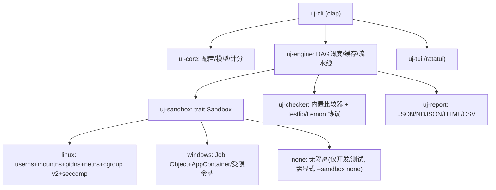

# uj —— 本地算法竞赛判题系统 · 执行计划

> 交付对象：负责编码的 AI（Gemini Flash）。请**严格按阶段推进**，每阶段完成后跑通该阶段的验收测试再进入下一阶段。
> 文中「必须 / MUST」为硬性要求，「建议 / SHOULD」可在有理由时偏离，但要在 `docs/DECISIONS.md` 记录原因。

---

## 0. 项目定位

| 项 | 内容 |
|---|---|
| 名称 | `uj`（工作区 `uj-cil`，二进制名 `uj`，可后续改名） |
| 形态 | 单一静态二进制 CLI，Rust（edition 2024，stable 工具链） |
| 主要用户 | **AI Agent 本地自动化出题**（其次：人类出题人、OI 模拟赛评测） |
| 平台 | Linux 为一等公民；Windows 完整支持；两套沙盒后端，统一抽象 |
| 核心卖点 | ① 轻量快速 ② 多核并行 ③ 沙盒健全（不残留/不逃逸/稳定）④ 判定准确 |

### 0.1 威胁模型（写进 README）
- 被测代码 = **可能有 bug 或恶意的代码**（Agent 生成的代码可能 `rm -rf`、fork 炸弹、无限输出、联网、留后台进程）。
- 必须保护：宿主文件系统（只读可见最小集合，仅工作目录可写）、宿主进程（不可见、不可 kill）、网络（完全断开）、系统稳定性（CPU/内存/进程数/输出量受限）。
- 不防御：内核 0day、侧信道。

### 0.2 性能目标（作为基准测试验收值）
- `uj` 冷启动 < 50 ms。
- Linux 单次沙盒运行额外开销 ≤ 5 ms；Windows ≤ 15 ms。
- 8 物理核机器：1 份 C++ A+B 程序 × 1000 个测试点，全流程（不含编译）< 3 s。
- 内置比较器：1 GB 输出比较 < 2 s（mmap + memchr 流式比较）。

---

## 1. 参考的同类项目（实现时可查阅其源码）

| 项目 | 借鉴点 |
|---|---|
| [isolate](https://github.com/ioi/isolate)（IOI/CMS） | cgroup v2 计量、box 目录模型、meta 输出字段 |
| [go-judge](https://github.com/criyle/go-judge) | namespaces+cgroup+seccomp 组合；Windows 用 Job Object；预热进程池 |
| [hakoniwa](https://github.com/souk4711/hakoniwa)（Rust） | Rust 下 namespace/pivot_root/seccomp/landlock 写法 |
| [nsjail](https://github.com/google/nsjail) / runc | 「re-exec 自身做 init」模式、挂载流程 |
| [seccompiler](https://github.com/rust-vmm/seccompiler)（Firecracker） | 纯 Rust 生成 seccomp BPF |
| [testlib](https://github.com/MikeMirzayanov/testlib) | checker/validator/interactor/generator 协议 |
| Polygon / TPS | 出题流程：generator→validator→main 生成答案→多解法期望结论校验→定 TL |
| CMS（Communication task） | 通信题：manager + 多个选手进程通过 FIFO 通信 |
| Lemon / LemonLime | OI 工程结构、SPJ 协议、子任务依赖 |
| DMOJ judge-server | 评测结论优先级、交互题判定规则 |

---

## 2. 总体架构



### 2.1 Cargo workspace 目录

```
uj-cil/
├─ Cargo.toml                 # [workspace]
├─ crates/
│  ├─ uj-cli/                 # main.rs, 子命令, 输出格式
│  ├─ uj-core/                # problem.toml/languages.toml 解析, Verdict, 计分, 测试发现
│  ├─ uj-sandbox/             # trait + linux/ windows/ none/ 后端, 平台探测(doctor)
│  ├─ uj-engine/              # 调度器, 编译, 运行, 缓存, 拓扑/绑核
│  ├─ uj-checker/             # 内置比较器, testlib/Lemon 适配, diff 摘要
│  ├─ uj-report/              # JSON schema(schemars), HTML(minijinja), CSV
│  └─ uj-tui/                 # ratatui 实时界面
├─ assets/                    # testlib.h(vendored), 默认 languages.toml, HTML 模板
├─ tests/evil/                # 恶意/边界程序 + 期望结论
├─ tests/problems/            # 集成测试用的示例题目
└─ docs/                      # DECISIONS.md, PROTOCOL.md(JSON 输出协议), SANDBOX.md
```

### 2.2 依赖（建议，版本用最新 stable）
- 通用：`clap`(derive) `serde` `serde_json` `toml` `schemars` `thiserror` `anyhow`(仅 cli) `tracing` `tracing-subscriber` `crossbeam-channel` `parking_lot` `blake3` `memchr` `memmap2` `globset` `regex` `tempfile` `which` `ctrlc` `minijinja` `ratatui` `crossterm` `indicatif` `num_cpus` `sysinfo`
- Linux：`rustix` 或 `nix` + `libc`、`seccompiler`、`landlock`（可选）
- Windows：`windows`（官方 windows-rs，按需开启 `Win32_System_JobObjects`、`Win32_Security_Isolation`、`Win32_System_Threading`、`Win32_Security_Authorization`、`Win32_System_Pipes`、`Win32_System_IO` 等 feature）
- **禁止引入 tokio**：全部用 std 线程 + crossbeam。子进程监控是阻塞式的，线程模型更简单可靠。

---

## 3. 核心数据模型（uj-core）

### 3.1 Verdict

```rust
pub enum Verdict {
    Accepted,            // AC
    WrongAnswer,         // WA
    PresentationError,   // PE（默认合并为 WA，可配置 pe_as_wa=false）
    PartiallyCorrect,    // PC（带 score）
    TimeLimitExceeded,   // TLE（附 reason: Cpu | Wall）
    MemoryLimitExceeded, // MLE
    OutputLimitExceeded, // OLE
    RuntimeError,        // RE（附 exit_code / signal / NTSTATUS 名称）
    RestrictedFunction,  // RF（seccomp 拦截 / Windows 子进程创建被拒）
    CompileError,        // CE
    JudgeFailed,         // SE：checker FAIL/崩溃、沙盒故障 —— 必须醒目报告
    Skipped,             // 子任务依赖失败或 fail-fast 跳过
}
```

### 3.2 运行规格 / 结果（沙盒层接口，平台无关）

```rust
pub struct Limits {
    pub cpu_time_ms: u64,        // 判 TLE 的依据
    pub wall_time_ms: u64,       // 默认 max(2*cpu, cpu+1000)
    pub memory_bytes: u64,       // 判 MLE 的依据
    pub stack_bytes: Option<u64>,// None=与 memory 相同（OI 惯例）
    pub output_bytes: u64,       // 默认 64 MiB
    pub stderr_bytes: u64,       // 默认 64 KiB，超出截断不判错
    pub max_processes: u32,      // C/C++ 默认 1；Java 等按语言配置
}

pub enum Stdio { Null, File(PathBuf), Pipe /*由引擎读取*/, Inherit /*仅交互/通信题用*/ }

pub struct RunSpec {
    pub argv: Vec<OsString>,
    pub env: Vec<(OsString, OsString)>,   // 最小环境，不继承宿主
    pub work_dir: PathBuf,                // 宿主侧 box 目录，沙盒内映射为 /box
    pub ro_binds: Vec<PathBuf>,           // 额外只读挂载(语言运行时)
    pub stdin: Stdio, pub stdout: Stdio, pub stderr: Stdio,
    pub extra_fds: Vec<RawFdOrHandle>,    // 交互/通信题用
    pub limits: Limits,
    pub cpu_affinity: Option<Vec<usize>>, // 绑核
    pub seccomp_profile: SeccompProfile,  // Default | Strict | Compiler
}

pub struct RunResult {
    pub status: ExitStatus,          // Exited(i32) | Signaled(i32) | NtStatus(u32)
    pub cpu_time_us: u64,            // 来自 cgroup cpu.stat / Job 计账
    pub wall_time_us: u64,           // Instant 单调时钟
    pub memory_peak_bytes: u64,
    pub killed_by: Option<KillReason>, // CpuLimit | WallLimit | MemoryLimit | OutputLimit | ProcessLimit | Seccomp | UserCancel
    pub oom_killed: bool,
    pub stdout: Option<CapturedOutput>, pub stderr_tail: Vec<u8>,
    pub residue_cleaned: bool,       // 结束后是否发现并清理了残留进程（应永远为 false；为 true 则记 warning）
    pub sandbox_tier: Tier,
}
```

### 3.3 problem.toml（题目配置，完整示例）

```toml
schema = 1
name = "aplusb"
type = "traditional"          # traditional | interactive | grader | communication | output_only

[limits]
time = "1s"                   # 支持 ms/s
memory = "512MiB"
stack = "same"                # same | "64MiB" | "unlimited"
output = "64MiB"

[io]
mode = "stdio"                # stdio | file
input_name = "aplusb.in"      # mode=file 时选手读写的文件名
output_name = "aplusb.out"

[checker]
type = "builtin"              # builtin | testlib | lemon
name = "wcmp"                 # builtin: exact|wcmp|lcmp|ncmp|rcmp4|rcmp6|rcmp9|yesno|hcmp|fcmp
# path = "checker.cpp"        # testlib/lemon 时

# interactor = "interactor.cpp"           # type=interactive
# grader = { files = ["grader.cpp"], headers = ["aplusb.h"] }  # type=grader
# manager = "manager.cpp"; processes = 2  # type=communication

validator = "validator.cpp"

[tests]
dir = "tests"
pattern = "auto"              # 自动识别 {name}.in + {name}.ans|.out，自然排序
samples = ["tests/sample1.in"]

[[tests.gen]]                 # 生成脚本（出题流程用）
generator = "gen"             # 对应 generators/gen.cpp
args = "--n 10 --v 100"
count = 3                     # 自动追加 --uj-index {i} 保证 testlib 随机种子不同
subtask = 1

[[tests.manual]]
input = "manual/edge1.in"
subtask = 2

[[subtasks]]
id = 1
score = 30
scoring = "min"               # min（捆绑, 取最低比例）| sum（按点求和）
tests = ["1-10"]              # 编号区间 / glob / 正则 "re:^small"
[[subtasks]]
id = 2
score = 70
scoring = "min"
depends = [1]                 # 依赖子任务失败 => 本子任务 Skipped 计 0

[[solutions]]
path = "solutions/std.cpp"
tag = "main"                  # main(唯一, 生成答案) | accepted | wrong_answer | time_limit | memory_limit | runtime_error | rejected(任意非AC) | partial
[[solutions]]
path = "solutions/brute.cpp"
tag = "rejected"
expect_subtasks = { 1 = "AC", 2 = "TLE" }   # 逐子任务期望，verify 时校验
```

未写 `[[subtasks]]` 时：所有测试点平分 100 分（用整数分配，余数加到前面的点，避免 Lemon 的整除误差）。

### 3.4 languages.toml（内置默认 + `~/.config/uj/languages.toml` + 题目目录同名文件，逐层覆盖）

```toml
[lang.cpp17]
ext = ["cpp", "cc", "cxx"]
compile = ["g++", "-std=c++17", "-O2", "-pipe", "-DONLINE_JUDGE", "-o", "{exe}", "{src}", "{extra_srcs}"]
compile_windows_extra = ["-static", "-Wl,--stack,{stack_bytes}"]   # MinGW: 静态链接 + 大栈
run = ["{exe}"]
time_factor = 1.0
max_processes = 1
seccomp = "strict"

[lang.c11]   # 同上，gcc -std=c11 -O2 -lm
[lang.cpp20] # g++ -std=c++20

[lang.python3]
ext = ["py"]
compile = ["python3", "-m", "py_compile", "{src}"]    # 仅语法检查
run = ["python3", "{src}"]
time_factor = 3.0
max_processes = 1
seccomp = "default"

[lang.java]
ext = ["java"]
compile = ["javac", "-encoding", "UTF-8", "-d", "{dir}", "{src}"]
run = ["java", "-Xss{stack_mb}m", "-Xmx{memory_mb}m", "-XX:+UseSerialGC", "-cp", "{dir}", "Main"]
time_factor = 2.0
max_processes = 64           # JVM 线程
memory_extra = "64MiB"       # JVM 元空间余量
ro_binds = ["/usr/lib/jvm"]

[lang.rust]
ext = ["rs"]
compile = ["rustc", "--edition", "2021", "-O", "-o", "{exe}", "{src}"]
run = ["{exe}"]
```
编译器版本（`g++ --version` 首行）必须进入缓存 key 和报告的 environment 字段。

---

## 4. CLI 设计（uj-cli）

### 4.1 子命令

| 命令 | 作用 |
|---|---|
| `uj init [dir] [--type ...]` | 生成题目骨架（含 vendored `testlib.h`、示例 gen/validator/std） |
| `uj build [targets]` | 编译题目内所有程序（并行，带缓存） |
| `uj gen` | 按 `[[tests.gen]]` 生成输入 |
| `uj validate` | validator 校验全部输入（testlib：传 `--group <subtask>`） |
| `uj ans` | 用 main 解法生成 `.ans`（同时检查 main 本身不 TLE/RE） |
| `uj judge <src...> [-p problem]` | 评测一份或多份代码 |
| `uj verify` | Polygon 式：所有 `[[solutions]]` 跑全部数据并核对期望结论 |
| `uj tl` | 计时校准，给出建议 TL 并检查 TLE 解法是否被卡住 |
| `uj stress --gen G --sol S --brute B [-n N] [--seed K]` | 并行对拍，首个不一致即停，保存 `stress/fail-<seed>.in` |
| `uj doctor [--problem]` | 环境体检（沙盒层级/内核/编译器/AppArmor/Defender）+ 题目体检 |
| `uj contest <dir>` | 多选手整场评测（Lemon 目录结构） |
| `uj import lemon <file.cdf>` | 导入 LemonLime 工程 |
| `uj report <run-id> --html/--csv` | 导出报告 |
| `uj last` / `uj show <run-id> [--test N]` | 查看最近结果 / 单点详情（diff、stderr、checker 信息） |
| `uj schema [config|result|events]` | 打印 JSON Schema（给 Agent 用） |

### 4.2 全局参数
`--format human|json|ndjson`（stdout 非 TTY 时默认 json）、`-j/--jobs N`、`--sandbox auto|full|degraded|none`、`--require-tier full`、`--precise`（启用临界点复测，默认开）、`--no-cache`、`--fail-fast`、`--tui`、`-q/-v`、`--color`。

### 4.3 输出协议（Agent 友好，MUST）
- **stdout 只输出结果**（json 模式下是且仅是一个 JSON 文档；ndjson 模式一行一个事件）。日志、进度一律走 stderr。
- 每份结果带 `"schema_version": 1`，结构由 `schemars` 生成并在 `docs/PROTOCOL.md` 记录；破坏性变更必须升版本号。
- 所有结果自动保存到 `.uj/runs/<时间戳>-<短hash>/result.json`，`uj last` 可直接取。
- 错误也必须是结构化 JSON：`{"ok":false,"error":{"kind":"ConfigError","message":"...","hint":"...","path":"problem.toml","line":12}}`

单点结果示例：
```json
{"id":"7","subtask":2,"verdict":"WA","score":0,"time_ms":132,"wall_ms":140,"memory_kb":10240,
 "exit":{"code":0},"checker":"wrong answer 3rd numbers differ - expected: '5', found: '6'",
 "diff":{"line":1,"column":5,"token_index":3,"expected":"... 4 5 7 ...","found":"... 4 6 7 ...","truncated":false},
 "timing":{"rejudged":false,"confidence":"high"}}
```

ndjson 事件：`compile_start / compile_done / test_start / test_done / subtask_done / submission_done / warning / summary`。

### 4.4 进程退出码（MUST，Agent 依赖）

| 码 | 含义 |
|---|---|
| 0 | 全部通过（judge 全 AC / verify 全部符合期望 / stress 未发现差异） |
| 1 | 存在非 AC 结论 / 对拍发现差异 |
| 2 | 配置或用法错误 |
| 3 | JudgeFailed：checker/validator FAIL、沙盒故障、残留进程 |
| 4 | verify 期望不符 |
| 5 | 编译错误 |
| 130 | Ctrl-C 取消（所有沙盒已清理） |

---

## 5. 沙盒设计（uj-sandbox）—— 本项目最关键部分

### 5.1 抽象

```rust
pub trait Sandbox: Send + Sync {
    fn tier(&self) -> Tier;                                   // Full | Degraded | None
    fn run(&self, spec: &RunSpec, cancel: &CancelToken) -> Result<RunResult, SandboxError>;
    /// 交互/通信题：同时启动多个进程，统一监控，任一超限可单独 kill，全部结束后返回
    fn run_group(&self, specs: &[RunSpec], wiring: &Wiring, cancel: &CancelToken) -> Result<Vec<RunResult>, SandboxError>;
    fn cleanup_stale(&self) -> Result<CleanupReport>;         // 启动时清理上次崩溃遗留
}
```
`SandboxError` 只表示**评测机故障**（→ JudgeFailed），选手程序的任何行为都必须体现在 `RunResult` 里，绝不能变成 Err。

### 5.2 Linux 后端（Tier Full，免 root）

**前置条件（`uj doctor` 逐项检测并给修复命令）**
- cgroup v2 统一层级挂载在 `/sys/fs/cgroup`。
- 非特权 user namespace 可用：检查 `/proc/sys/user/max_user_namespaces > 0`、`/proc/sys/kernel/unprivileged_userns_clone`（Debian 系）、**Ubuntu 23.10+/24.04 的 `kernel.apparmor_restrict_unprivileged_userns=1`**（需为 uj 安装 AppArmor profile：`/path/to/uj flags=(unconfined) { userns, }`，`uj doctor --fix-apparmor` 打印/写入该 profile）。
- cgroup 委派：非 root 时，uj 启动检测自身 cgroup 是否可写；不可写则**自动 re-exec**：`systemd-run --user --scope --quiet -p Delegate=yes -- /proc/self/exe <原参数>`（设置环境变量 `UJ_DELEGATED=1` 防止循环）。
- **内核版本必须 ≥ 5.19**（依赖 `memory.peak` 5.19、`cgroup.kill` 5.14、`subset=pid` 5.8、pidfd 5.3）。启动时检测 `uname -r`，低于 5.19 时拒绝启用任何 Linux 沙盒层级，以退出码 3 报错并提示升级内核；只有显式 `--sandbox none` 可以继续运行。**不为旧内核写任何兼容代码。**

**cgroup 布局**
```
<delegated_root>/                 # systemd scope
├─ judge/                         # uj 主进程把自己移入此叶子（遵守 no-internal-process 规则）
└─ run-<judgePid>-<seq>/          # 每次运行一个叶子
```
- 根节点 `cgroup.subtree_control` 写入 `+memory +pids`（`+cpu` 可选；`cpu.stat` 的 `usage_usec` 不依赖 cpu 控制器）。
- 每次运行：`memory.max = ML + 语言 memory_extra`、`memory.swap.max = 0`、`memory.oom.group = 1`、`pids.max = max_processes + 1`（+1 为 mini-init）。

**进程树与启动时序（MUST 照此实现）**

```mermaid
sequenceDiagram
    participant J as uj worker 线程
    participant H as helper (re-exec 的 uj __sandbox-init)
    participant C as init (新 pidns 的 PID 1)
    participant G as 选手程序 (PID 2)
    J->>J: 创建 run cgroup / box 目录 / 管道(O_CLOEXEC) / 打开 stdin 文件
    J->>H: spawn /proc/self/exe __sandbox-init（配置经继承的 fd 以 JSON 传入）
    H->>H: prctl(PDEATHSIG,SIGKILL); unshare(NEWUSER); 写 setgroups=deny, uid_map, gid_map
    H->>H: unshare(NEWPID|NEWNET|NEWIPC|NEWUTS)
    H->>C: fork
    C->>C: PDEATHSIG; unshare(NEWNS); mount --make-rprivate /; 组装 root; pivot_root; 挂 /proc
    C->>H: sync 管道写 "ready"
    H->>H: 把 C 的 pid 写入 run cgroup 的 cgroup.procs
    H->>J: 状态 fd 报告 C 的宿主 pid
    H->>C: sync 管道写 "go"
    C->>G: fork
    G->>G: setrlimit; chdir /box; 关闭多余 fd; no_new_privs; seccomp; execve
    G-->>C: 退出
    C->>H: 状态管道: G 的 wait 状态 + rusage
    C->>C: exit → 内核杀死该 pidns 内所有剩余进程
    H->>J: 状态 fd 转发结果后退出
```

要点与理由：
1. **re-exec 自身做 helper**：helper 是全新的单线程进程，规避「多线程进程 fork 后只能调用 async-signal-safe 函数」的问题。
2. **选手程序不能当 PID 1**：PID 1 会忽略没有处理函数的信号（含自己发的 `abort()`），会把 RE 判错。所以必须由 C 当 mini-init，选手程序作为 PID 2。
3. **C 必须自己 `unshare(NEWNS)`**：如果 helper 和 C 在同一个 mount ns 里 pivot_root，会连带改掉 helper 的根目录。
4. **C 一退出，内核会杀掉整个 pidns** → 后台进程、`setsid` 的进程、双重 fork 的守护进程全部清掉。再加 cgroup.kill 兜底，保证不残留。
5. 进 cgroup 的时机放在 exec 前，所以 setup 开销几乎不计入 CPU 时间。

**沙盒内文件系统（root 为 tmpfs，size=16M）**
- 只读 bind（`MS_BIND|MS_REC` 后再 `MS_REMOUNT|MS_BIND|MS_RDONLY|MS_NOSUID|MS_NODEV`）：`/usr /lib /lib64 /bin /sbin`（merged-usr 时是符号链接，照原样建链接）、`/etc/ld.so.cache`、`/etc/alternatives`，以及语言配置里的 `ro_binds`。
- `/box`：读写 bind 到宿主 run 目录（用户程序的 cwd）。
- `/tmp`：tmpfs `size=64M`（会计入 memory cgroup，符合预期）。
- `/proc`：在新 pidns 里新挂一份，挂载选项 `hidepid=2,subset=pid`。
- `/dev`：只 bind 宿主的 `null zero full random urandom`（userns 里不能 mknod）。
- 不挂 `/sys`、`/home`、`/root`、`/run`。
- ⚠ userns 中 remount 必须**保留原挂载上已锁定的 flag**（nosuid/nodev/noexec/relatime 等），否则会 EPERM。实现时先用 `statvfs` 读出原 flag 再 OR 进去。

**rlimit（只设在 G 上）**
- `RLIMIT_STACK` = stack 配置（默认等于内存限制）
- `RLIMIT_FSIZE` = output 限制（触发 SIGXFSZ → 判 OLE）
- `RLIMIT_CORE = 0`，`RLIMIT_NOFILE = 64`，`RLIMIT_MEMLOCK = 0`
- `RLIMIT_CPU = ceil(TL)+1` 秒，只作兜底（SIGXCPU → 判 TLE）
- **不要设 `RLIMIT_NPROC`**（它按真实 uid 统计，会把宿主上同用户的进程也算进去），进程数用 `pids.max` 限制。
- **不要设 `RLIMIT_AS`**（会破坏 Java/Go/ASan），内存交给 cgroup。

**seccomp（用 `seccompiler` 生成）**
- 先校验架构：只允许本机原生架构（x86_64 / aarch64），x32 和 ia32 ABI 一律 KILL，防止绕过过滤。
- `default` 档（所有语言通用）：默认放行，下列 syscall 返回 `EPERM`：`ptrace process_vm_readv process_vm_writev mount umount2 pivot_root chroot setns unshare kexec_load kexec_file_load init_module finit_module delete_module bpf perf_event_open userfaultfd keyctl add_key request_key reboot swapon swapoff settimeofday clock_settime adjtimex acct quotactl open_by_handle_at name_to_handle_at io_uring_setup io_uring_enter io_uring_register personality(非0参数) fanotify_init`。
- `clone`：做参数过滤，flags 中含任一 `CLONE_NEW*` 就返回 EPERM。
- `clone3`：参数是结构体指针，没法过滤，**统一返回 `ENOSYS`**，glibc 会自动回退到 `clone`（Docker/Flatpak 也是这么做的）。
- `strict` 档（C/C++ 默认）：在 default 基础上，把 `ptrace`、`process_vm_*`、`socket(非AF_UNIX)`、`fork/vfork/clone(非线程)` 改为 `KILL_PROCESS` → 判 RF。注意：设 RF 是为了让 Agent 明确知道代码用了禁止的功能。
- `compiler` 档：编译阶段使用，比 default 宽松，允许 fork/exec（gcc 要调用 cc1/as/ld）。

**计量（运行结束后读取）**
- CPU：`cpu.stat` 的 `usage_usec`（覆盖所有子进程和线程，精度 µs）。
- 内存：`memory.peak`。同时记录 wait4 的 `ru_maxrss` 作为调试字段（不参与判定）。
- OOM：`memory.events` 里的 `oom_kill > 0` → MLE。
- 进程数：`pids.events` 里的 `max > 0` → 记录为 `ProcessLimit`；C/C++ 下判 RF，其它语言判 RE。
- 墙钟：`Instant`，从 helper 写 "go" 开始计时。

**监控线程（每次运行一个）**
- 用 helper 的 pidfd（`pidfd_open`）+ `poll(timeout=5ms)` 等待退出；每个周期读一次 `cpu.stat` 和墙钟。
- CPU 超过 TL（再留 10% 余量才 kill，节省时间但判定仍以真实值为准）或墙钟超限：写 `cgroup.kill`。只有写入失败（属于异常情况，同时记 warning）时，才退而 `kill(C_host_pid, SIGKILL)`（杀 PID 1 等于杀整个 pidns）。
- 结束后**残留断言**：最多轮询 100 ms，直到 `cgroup.procs` 为空，然后 `rmdir` cgroup。如果 100 ms 后仍有进程：强制 kill，`residue_cleaned = true`，结果加 warning。

**stdout/stderr 处理（准确性关键）**
- stdout 用 **pipe**，由引擎线程读出写入宿主文件，超过 output 限制就 kill 并判 OLE。理由：如果让选手直接写 tmpfs 或磁盘文件，page cache/shmem 会计入选手的 memory cgroup，导致内存虚高。
- stdin 直接传入只读打开的输入文件 fd。
- stderr 用 pipe，只保留尾部 64 KiB。
- `io.mode = file` 时：把输入复制进 box，运行后从 box 读取输出文件（这时 page cache 计入内存是不可避免的，在文档中说明；`memory_extra` 可以补偿）。

**崩溃安全 / 不残留（三重保障）**
1. helper 和 C 都设置 `PDEATHSIG=SIGKILL`。⚠ PDEATHSIG 是在**创建它的线程**退出时触发，不是进程退出时。所以 worker 线程必须是常驻线程池，不能每次运行开一个临时线程去 spawn。
2. pidns 的 init 一死，内核就清空整个命名空间。
3. uj 启动时执行 `cleanup_stale()`：扫描 `run-<pid>-*`，对应 pid 已不存在的，写 cgroup.kill 后 rmdir；同时清理 `.uj/tmp` 下的残留目录。
4. Ctrl-C：`ctrlc` 回调设置全局 CancelToken，所有监控线程立刻 kill，等全部清理完毕后以退出码 130 退出。

#### 5.2.7 降级层级（前提都是内核 ≥ 5.19）

| Tier | 条件 | 能力 |
|---|---|---|
| Full | userns + cgroup 委派 | 上面全部 |
| Full(root) | 以 root 运行 | 不需要 userns，直接在 `/sys/fs/cgroup/uj/` 下建 cgroup；每个 worker 使用独立 uid（类似 isolate 的 box-id） |
| Degraded | 有 userns，没有 cgroup | 进程隔离靠 pidns；内存用 `RLIMIT_DATA` 加轮询 `/proc/<pid>/status` 的 VmHWM；CPU 用 wait4 rusage 加轮询 `/proc/<pid>/stat`；所有结果标记 `timing.confidence = "low"` |
| None | `--sandbox none` 显式指定 | 只用 rlimit，**不安全**，每次运行都在 stderr 打警告；只用于开发和 CI 调试 |

`--require-tier full` 时如果达不到 Full，直接退出码 3 并给出 doctor 建议。

### 5.3 Windows 后端（Tier Full = AppContainer + Job Object）

**一次性初始化**
- `CreateAppContainerProfile("uj.sandbox", ...)`；已存在就用 `DeriveAppContainerSidFromAppContainerName` 取 SID。
- 给 run 根目录（`.uj\tmp`）授予该 SID 读写权限（`SetNamedSecurityInfoW` 加 ACE，可继承）。如果语言运行时目录（Python 安装目录等）需要访问，按语言配置授予读+执行权限。System32 默认已授权给 ALL APPLICATION PACKAGES。
- AppContainer 不声明任何 capability → **自动断网**。

**每次运行**
1. `CreateJobObjectW`，设置 `JOBOBJECT_EXTENDED_LIMIT_INFORMATION`：
   - `KILL_ON_JOB_CLOSE`：uj 进程无论以何种方式死亡，句柄被系统关闭，作业内所有进程随之被杀 → 不残留。
   - `DIE_ON_UNHANDLED_EXCEPTION`：不弹 WER 错误对话框（否则会卡住到墙钟超时）。
   - `ACTIVE_PROCESS`：限制为 max_processes。
   - `JOB_MEMORY`：`JobMemoryLimit = ML + memory_extra`。
   - `AFFINITY`：绑核。
   - 不设置 `BREAKAWAY_OK`。
2. `JOBOBJECT_BASIC_UI_RESTRICTIONS`：全部 UILIMIT 位（DESKTOP、DISPLAYSETTINGS、EXITWINDOWS、GLOBALATOMS、HANDLES、READCLIPBOARD、WRITECLIPBOARD、SYSTEMPARAMETERS）。
3. 把 IO 完成端口关联到 Job（`JobObjectAssociateCompletionPortInformation`），接收 `ACTIVE_PROCESS_ZERO`、`JOB_MEMORY_LIMIT`/`PROCESS_MEMORY_LIMIT`（→ MLE 标志）、`ACTIVE_PROCESS_LIMIT`（→ 创建子进程被拒）等消息。
4. `CreateProcessW` 使用 `EXTENDED_STARTUPINFO_PRESENT`，属性列表：
   - `PROC_THREAD_ATTRIBUTE_HANDLE_LIST`：**只允许继承 stdin/stdout/stderr 这三个句柄**（防止并行评测时句柄串到别的子进程里，导致管道永远收不到 EOF 而卡死——这是最常见的 Windows 并行评测 bug）。
   - `PROC_THREAD_ATTRIBUTE_SECURITY_CAPABILITIES`：AppContainer。
   - `PROC_THREAD_ATTRIBUTE_JOB_LIST`（Win10+）：进程一诞生就在 Job 里，没有逃逸窗口；不支持时退回 `CREATE_SUSPENDED` → `AssignProcessToJobObject` → `ResumeThread`。
   - `PROC_THREAD_ATTRIBUTE_CHILD_PROCESS_POLICY = PROCESS_CREATION_CHILD_PROCESS_RESTRICTED`（max_processes == 1 时）。
   - flags：`CREATE_UNICODE_ENVIRONMENT | CREATE_NO_WINDOW | CREATE_SUSPENDED`（配合计时起点）。
   - 环境变量块最小化：`SystemRoot`、`PATH`（仅必要目录）、`TEMP/TMP` 指向 box。
5. 父进程在 spawn 前调用 `SetErrorMode(SEM_FAILCRITICALERRORS|SEM_NOGPFAULTERRORBOX|SEM_NOOPENFILEERRORBOX)`（错误模式会被子进程继承）。
6. 监控：`WaitForSingleObject(hProcess, 5ms)` 循环 + `QueryInformationJobObject(JobObjectBasicAccountingInformation)`，取 `TotalUserTime + TotalKernelTime`（单位 100ns）。超限就 `TerminateJobObject`，然后等待 `ACTIVE_PROCESS_ZERO`。
7. 计量：CPU 取作业计账；内存取 `JobObjectExtendedLimitInformation.PeakJobMemoryUsed`（**提交内存 commit**，见下方差异说明）；退出码用 `GetExitCodeProcess`，NTSTATUS 映射为可读名称：`0xC0000005 ACCESS_VIOLATION`、`0xC00000FD STACK_OVERFLOW`、`0xC0000094 INT_DIVIDE_BY_ZERO`、`0xC0000409 STACK_BUFFER_OVERRUN/FAST_FAIL`、`0xC0000017 NO_MEMORY`、`0xC000001D ILLEGAL_INSTRUCTION`、`0xC0000135 DLL_NOT_FOUND`（这个判 SE 并提示用 `-static`）。
8. 关闭 Job 句柄，删除 box 目录。

**降级（Tier Degraded）**：AppContainer 不可用时，改用 `CreateRestrictedToken(DISABLE_MAX_PRIVILEGE|LUA_TOKEN)` + 低完整性级别（S-1-16-4096）+ Job。此时**无法断网、可以读宿主文件**，必须打警告。

**Windows 特有注意事项（写进 docs/SANDBOX.md）**
- 内存口径：Windows 统计的是 commit，Linux 统计的是实际驻留页。比如 `static int a[1e8]` 但只用一小部分：Windows 会全额计入，Linux 不会。这个差异必须写进报告的 environment 说明。
- Windows Defender 会扫描刚生成的 exe，导致首次运行墙钟大幅增加（CPU 时间不受影响）。`uj doctor` 要检测并建议把 `.uj` 目录加入排除项；墙钟限制要留足余量。
- MinGW 默认栈只有 1 MB → 默认编译参数加 `-Wl,--stack,<stack_bytes>`；必须 `-static`，否则可能找不到 libstdc++ DLL。
- 所有路径使用宽字符 API（`OsStr` → UTF-16），必须支持中文路径。
- 句柄全部用 RAII 包装（`OwnedHandle`）。

### 5.4 结论判定顺序（单进程，MUST 按此顺序）
1. `SandboxError` → JudgeFailed
2. exec 失败（找不到解释器、格式错误）→ JudgeFailed，附 errno
3. `killed_by == CpuLimit` 或 `cpu_time > TL` → **TLE(Cpu)**
4. `killed_by == WallLimit` → **TLE(Wall)**（如果 cpu < 0.5·TL，在 message 里提示「可能在等待输入或 sleep」）
5. `oom_killed` 或 `memory_peak > ML` → **MLE**
6. `OutputLimit` 或 SIGXFSZ → **OLE**
7. seccomp 的 SIGSYS / Windows 创建子进程被拒 → **RF**
8. 被信号终止、退出码非 0、NTSTATUS 异常 → **RE**（`ignore_exit_code = true` 时跳过退出码判断）
9. 否则进入 checker：返回 AC / WA / PE / PC(score)；checker 返回 FAIL、崩溃或超时 → **JudgeFailed**（整体退出码 3，报告置顶醒目显示）

---

## 6. 并行调度与计时准确性（uj-engine）

### 6.1 CPU 拓扑与「槽位」
- 启动时探测拓扑：Linux 读 `/sys/devices/system/cpu/cpu*/topology/{core_id,physical_package_id,thread_siblings_list}`；Windows 用 `GetLogicalProcessorInformationEx(RelationProcessorCore)`。
- **槽位（slot）= 一个物理核**，每个物理核只取一个逻辑 CPU。SMT 的兄弟线程不放评测任务，因为它们共享执行单元，会干扰计时。
- 预留 1 个物理核给 uj 自身（管道读取、比较器、调度）。
- 默认 `jobs = 物理核数 − 1`（最少 1）。另外受内存约束：`jobs = min(jobs, floor(可用内存 × 0.8 / ML))`。
- 选手程序运行时绑定到槽位核心：Linux 用 `sched_setaffinity`（在 G 里设置），Windows 用 Job 的 Affinity。
- **编译任务不占槽位**：使用独立线程池，并发数为逻辑核数（编译耗时不影响判定）。编译阶段与运行阶段有依赖时自然串行；不同提交之间可以重叠进行。

### 6.2 任务 DAG
```
compile(prog) ──► run(sub, test) ──► check(sub, test) ──► aggregate(subtask) ──► aggregate(submission)
gen(test) ──► validate(test) ──► ans(test, main)          （出题流程）
```
- 调度器：一个就绪队列（优先级：编译 > 运行 > 其他）+ 槽位信号量。运行任务按**输入文件大小降序**排列（LPT 启发式，缩短总耗时）。
- checker 在同一槽位、选手程序结束后**紧接着运行**，避免与其它槽位争抢资源；内置比较器直接在 worker 线程内执行，不启动进程。
- 交互题和通信题**原子性地申请 k 个槽位**（k = 同时运行的进程数）。
- `--fail-fast`：子任务计分为 min 时，一个点失败就把同子任务剩余的点标记为 Skipped（还没启动的直接跳过）。

### 6.3 临界点复测（`--precise`，默认开启）
- 并行阶段结束后，把满足以下条件的点挑出来：`0.9·TL ≤ cpu ≤ 1.5·TL`，或判 TLE 但 `cpu < 1.5·TL`。
- 进入**独占阶段**：`jobs = 1`，其它槽位空闲；每个点最多复测 `rejudge_times`（默认 2）次，**取最小 CPU 时间**重新判定。
- 报告中记录 `timing.rejudged = true`、所有样本值，以及 `confidence`：high（远离 TL）/ medium（复测后确定）/ low（Degraded 层级或复测结果波动 > 10%）。
- `uj doctor` 检查：CPU 调频策略不是 performance 时给出提示；笔记本使用电池时给出提示。

### 6.4 缓存与增量（Agent 会反复迭代，必须快）
- 编译缓存：`.uj/cache/bin/<blake3>/`，key = 语言 id + 编译器版本首行 + 完整编译参数 + 所有源文件和头文件内容。
- 答案缓存：`.uj/cache/ans/<main_exe_hash>/<input_hash>`。
- 生成缓存：key = generator 可执行文件 hash + 参数；输入文件已存在且 hash 一致就跳过。
- 运行结果**不缓存**（计时每次都要重新测量）。
- `.uj/` 自动写入 `.gitignore`。`uj clean` 清除缓存。

---

## 7. 评测类型与 checker 协议（uj-checker）

### 7.1 内置比较器（Rust 原生，不启动进程，命名与 testlib 标准 checker 保持一致）

| 名称 | 规则 |
|---|---|
| `exact` | 逐字节完全一致 |
| `fcmp` | 逐行比较，忽略行尾空白和文末空行 |
| `wcmp`（默认） | 按空白分词逐个比较 token |
| `lcmp` | 逐行比较，每行内按 token 比较 |
| `ncmp` | 有符号 64 位整数序列 |
| `hcmp` | 任意长度整数（字符串规范化后比较，处理 `-0`、前导零） |
| `rcmp4/6/9` | 浮点数，绝对或相对误差 ≤ 1e-4 / 1e-6 / 1e-9（任一满足即可）；正确处理 nan/inf |
| `yesno` | 单个 token，大小写不敏感 |

- 所有比较器都把 `\r` 当作空白处理（Windows 生成的 `.ans` 常带 `\r\n`）；只有 `exact` 例外。
- 大文件用 `memmap2` 映射，配合 `memchr` 流式扫描。
- WA 时生成 diff 摘要：第一个不同的 token 序号、行号、列号，以及期望值/实际值附近的上下文（截断到 200 字符）。PE 的判断（只有空白不同）仅在 `exact`/`fcmp` 模式下有意义。

### 7.2 testlib checker
- 调用方式：`checker <input> <output> <answer> <result_file> -appes`，在沙盒中运行（profile=default，TL 默认 10 s，ML 1 GiB）。
- **优先解析 `-appes` 写出的 XML 结果文件**（`outcome` 属性 accepted / wrong-answer / presentation-error / fail / points / partially-correct，以及 `points` 属性）；如果文件不存在，退回到按退出码判定，同时取 stderr 作为消息。
- 退出码映射：0=AC，1=WA，2=PE，3=FAIL，4=DIRT（判 WA），7=POINTS，8=UNEXPECTED_EOF（判 WA）；partially 用 `16 + n` 表示。
- ⚠ 实现前**必须阅读仓库中 vendored 的 `assets/testlib.h`**，核对上述常量和 `-appes` 的输出格式；再为 ok/wa/pe/fail/points/partially 各写一个 checker，作为 golden test 固化下来。以源码为准，本文档仅供参考。

### 7.3 Lemon SPJ
- 调用方式：`spj <input> <output> <answer> <full_score> <score_file> <message_file>`。
- 从 score_file 读取得分（整数），从 message_file 读取消息。得分等于满分为 AC，0 为 WA，介于两者之间为 PC。

### 7.4 交互题（testlib interactor）
- 接线：interactor 的 stdout → 选手 stdin；选手 stdout → interactor stdin。
- interactor 的参数：`<input> <tout_file> [answer]`。interactor 的结论就是本点结论；如果配置了 checker，再用 tout 运行 checker。
- 两个进程都放进 `run_group`，分别设置限制。墙钟限制覆盖整个组。
- 父进程在 spawn 后**必须立刻关闭自己手里的管道端**，否则会死锁。
- 判定规则（参考 Codeforces/DMOJ）：
  1. interactor 返回 FAIL 或崩溃 → JudgeFailed。
  2. 选手 TLE/MLE/RE/OLE/RF，并且是在 interactor **结束之前**发生的 → 判选手的这个结论。
  3. interactor 先以 WA/PE 结束，选手随后因为 SIGPIPE 或读到 EOF 而退出 → 判 WA（不算 RE）。
  4. 双方都在阻塞（墙钟超时，CPU 时间很低）→ TLE(Wall)，消息为「Idleness limit exceeded」。
  5. 其它情况 → 采用 interactor 的结论。
- 需要记录每个进程的退出时间戳（单调时钟），用于判断先后顺序。

### 7.5 grader 题（函数式交互，NOI 常见）
- 编译时把选手源码与 `grader.files` 链接在一起，`headers` 复制到编译目录；其它流程与传统题相同。

### 7.6 通信题（CMS Communication 风格）
- 1 个 manager + `processes` 个选手进程实例。每个实例与 manager 之间有一对管道（Linux 用 pipe fd，Windows 用匿名管道句柄）。
- manager 通过参数得知各个 fd/句柄编号（Linux 传 `/proc/self/fd/N` 路径；Windows 传句柄数值）；选手的 stdin/stdout 接到对应管道。
- manager 从 stdin 读取测试输入，输出 `score\n` 和消息（兼容 CMS 的格式：stdout 第一行为 0~1 的浮点得分，stderr 为消息）。
- 每个选手进程分别计时、计内存，按「所有实例中最大值」与限制比较（可配置为求和）。

### 7.7 提交答案题（output_only）
- 提交物是一个目录（或 zip），里面放 `<test>.out`；不运行程序，直接对每个测试点调用 checker。

### 7.8 子任务计分
- `min`：子任务得分 = score × min(各点得分比例)；`sum`：score × 平均比例。
- `depends`：任一依赖子任务没有拿满分 → 本子任务记为 Skipped，0 分（默认规则，可配置为「依赖子任务得分为 0 才跳过」）。
- 依赖关系必须做环检测，有环 → ConfigError。
- 分数统一用定点数（×10⁶ 的整数）累加，避免浮点误差，输出时保留 3 位小数。

---

## 8. 出题工作流（面向 AI Agent 的核心场景）

一条命令跑完整流程：`uj build && uj gen && uj validate && uj ans && uj verify && uj tl`，或者直接 `uj pipeline`（按顺序执行，任一步失败即停，输出结构化 JSON）。

| 步骤 | 关键行为 | 失败时 |
|---|---|---|
| gen | generator 在沙盒中运行（profile=default），stdout 写入 `tests/<n>.in`；自动编号；testlib 生成器追加 `--uj-index i` 参数改变随机种子 | 报出是哪条 gen 配置、哪个参数失败 |
| validate | 每个输入都跑 validator，并传入 `--group <subtask>`；validator 的 stderr 原样保留 | 报出失败的文件和 validator 消息，退出码 3 |
| ans | main 解法生成 `.ans`；main 在任何点上 TLE/RE → 报错 | 退出码 3 |
| verify | 所有 `[[solutions]]` × 所有测试点；核对 `tag` 和 `expect_subtasks` | 列出不符合期望的解法，退出码 4 |
| tl | main 和所有 accepted 解法在独占模式下各跑 3 次，取最大 CPU 时间 T；建议 `TL = 向上取整到 100ms(max(2·T_main, 1.5·T_slowestAC))`；再检查每个 time_limit 解法在至少一个点上 ≥ 1.2·TL | 输出建议值和余量表；`--apply` 时写回 problem.toml |
| doctor --problem | 检查 .in/.ans 是否成对、重复数据（hash）、样例是否与 statement.md 中的代码块一致、子任务是否覆盖了全部测试点、TL 余量、checker 能否编译 | 输出 warning 列表 |

**tag 语义**：`main`/`accepted` = 全部 AC；`wrong_answer` = 至少一个 WA 且没有 TLE/RE…（与 Polygon 一致：必须出现该结论，且不得出现其它失败类型）；`time_limit`、`memory_limit`、`runtime_error` 同理；`rejected` = 至少一个非 AC；`partial` = 总分介于 0 和满分之间。

**stress（对拍）**
- 每个槽位运行一个循环：seed → gen → brute 和 sol 都跑（二者都在沙盒中）→ 用题目的 checker（或 wcmp）比较。
- 全局原子计数分配 seed；任一槽位发现不一致 → 广播取消 → 保存 `stress/fail-<seed>.{in,brute.out,sol.out}`，打印复现命令，退出码 1。
- `--time-budget 60s` 或 `-n N`，两者满足其一即停止。

---

## 9. 报告与 TUI

- JSON：见 4.3。
- CSV：每行一个（选手/提交, 题目, 测试点, 结论, 时间, 内存, 得分）。
- HTML：单个自包含文件（CSS 内联，无外部依赖），用 minijinja 模板渲染。深色主题；结论用色块表示（AC 绿 / WA 红 / TLE 橙 / MLE 紫 / RE 粉 / SE 黑底红字）；子任务可折叠；点击测试点显示 diff 和 checker 消息；整场比赛模式显示排行榜。
- TUI（`--tui`，或人类模式下 stderr 是 TTY 时自动启用）：ratatui 实现。显示槽位占用（每个物理核当前在跑什么）、测试点网格（实时着色）、子任务得分、日志面板。按 `q` 时安全取消（走 CancelToken）。
- 人类模式下非 TUI 时，用 indicatif 显示进度条，最后打印表格。

---

## 10. 测试策略

### 10.1 恶意/边界程序矩阵（`tests/evil/`，Linux 和 Windows 都必须全部通过）

| 程序 | 期望 |
|---|---|
| 死循环 | TLE(Cpu)，CPU 时间 ≈ TL（误差 < 50ms） |
| `sleep(100)` | TLE(Wall)，CPU ≈ 0 |
| 读 stdin 但不给 EOF 的交互场景 | TLE(Wall) |
| malloc 并逐页写满 2×ML | MLE |
| malloc 2×ML 但不访问（Linux） | AC（记录差异：Windows 判 MLE） |
| 深递归 1e6 层（栈 = ML） | AC |
| 深递归直到栈溢出 | RE（SIGSEGV / STACK_OVERFLOW） |
| fork 炸弹 | RF（C/C++）或 RE；运行结束后宿主上该用户的进程数恢复原状 |
| fork 后父进程退出，孙进程 `setsid` 并 sleep | 父进程结束后，**孙进程必须被杀**（检测宿主上不存在该进程） |
| 无限输出 `while(1) putchar('a')` | OLE，且宿主磁盘上产生的文件 ≤ output 限制 |
| 无限写 stderr | 不卡死，stderr 被截断，结论由其它条件决定 |
| 读 `/etc/shadow`、`~/.ssh/id_rsa`、`C:\Users\*` | 打开失败（程序打印失败即视为通过） |
| 写 `/box` 以外的路径 | 失败 |
| `connect` 到 1.1.1.1:80 | 失败 |
| `kill(-1, SIGKILL)` | 宿主进程不受影响 |
| `ptrace(PTRACE_TRACEME)` | strict 档下判 RF |
| `abort()` / `assert(0)` | RE(SIGABRT)（验证没有 PID 1 问题） |
| 除以 0、空指针 | RE，并给出对应的信号名或 NTSTATUS 名 |
| `return 1` | RE(exit 1) |
| 8 线程忙等 1 s（max_processes 允许时） | CPU 时间 ≈ 8 s → TLE（CPU 时间按所有线程累计） |
| 关闭 stdout 后退出 | WA（输出为空） |
| unshare / mount / clone3 | 失败（EPERM / ENOSYS） |
| Windows：MessageBox / 弹窗 | 不弹窗，不卡住 |
| Windows：`*(int*)0=0`（WER） | RE，且不出现错误报告对话框 |
| 并行 64 个上述程序混合运行 3 轮 | 全部结论正确；结束后**零残留**（Linux：委派 cgroup 下没有 run-*；Windows：任务管理器中没有残留进程） |
| 评测中途 `kill -9 uj` | 下次启动 cleanup_stale 能清理干净；运行中的子进程已被内核或 Job 杀死 |

每个程序都配有 `expect.toml`（期望结论 + 断言），由集成测试 `cargo test -p uj-sandbox --test evil` 驱动执行。

### 10.2 其它测试
- 单元测试：配置解析（含错误行号）、测试点自动发现与自然排序、计分（含定点数与依赖关系）、每个内置比较器的正反例（含 `\r\n`、nan、超长整数、空文件）、testlib golden test、Lemon SPJ golden test。
- 端到端测试：`tests/problems/` 下放 6 道示例题，覆盖 6 种题型；每道题都带 AC/WA/TLE/MLE/RE 解法，用 `uj verify` 跑通。
- 计时准确性测试：校准程序（busy-loop 精确跑 500ms），在 `-j 1` 和 `-j max` 下各跑 20 次，CPU 时间偏差中位数 < 3%，最大值 < 8%。
- 基准测试：criterion 测内置比较器；脚本测 0.2 节的性能目标。
- CI（GitHub Actions）：ubuntu-latest（需要先执行 `sudo sysctl -w kernel.apparmor_restrict_unprivileged_userns=0`，或者以 root 跑 Full(root) 层级）、windows-latest（MinGW 用 `msys2/setup-msys2`）。clippy `-D warnings`，fmt 检查。

---

## 11. 分阶段执行计划（每阶段结束时：验收测试全部通过 + 提交一次 commit）

### P0 脚手架（0.5 天）
- 建立 workspace 和各 crate 骨架；配置 CI、rustfmt、clippy；`release` profile 设置 `lto="thin"`、`codegen-units=1`、`strip=true`。
- uj-core：Verdict、Limits、RunSpec、RunResult、problem.toml / languages.toml 的数据结构与解析（serde + 带行号的错误信息）；测试点发现。
- uj-cli：clap 子命令骨架，`--format`，结构化错误，`uj schema`。
- **验收**：`uj schema result` 能输出合法的 JSON Schema；配置解析的单元测试通过。

### P1 Linux 沙盒（3 天，最重要）
- 按 5.2 节逐项实现：探测与 doctor → cgroup 管理（含 systemd-run re-exec、judge 叶子节点、清理残留）→ helper/init/G 三级进程与同步管道 → 挂载 → rlimit → seccomp → 监控线程 → 计量 → kill 与残留断言 → 降级层级 → `--sandbox none`。
- `uj run -- <cmd>` 调试命令：在沙盒里运行任意程序，打印 RunResult 的 JSON（以后 Agent 也会用到）。
- **验收**：10.1 中所有 Linux 项通过；`uj doctor` 在 Ubuntu 24.04 上能正确识别 AppArmor 限制并给出修复方法；单次运行开销 ≤ 5ms（用 `/bin/true` 跑 1000 次测量）。

### P2 Windows 沙盒（2.5 天）
- 按 5.3 节实现：AppContainer profile 与 ACL → Job 与 IOCP → 带属性列表的 CreateProcessW → 监控与计量 → NTSTATUS 映射 → 降级层级。
- **验收**：10.1 中所有 Windows 项通过（包括中文路径、WER 不弹窗、kill uj 后零残留）。

### P3 传统题评测流水线（2 天）
- 编译（沙盒 + compiler profile + 编译缓存 + CE 信息截断到 10 KiB）、拓扑探测与槽位、调度 DAG、stdout 管道读取、内置比较器、5.4 节的判定顺序、diff 摘要、json/ndjson/human 输出、`.uj/runs` 保存、`uj judge`/`uj last`/`uj show`、Ctrl-C 取消。
- **验收**：A+B 题 1000 个点的性能目标达标；`-j 1` 与 `-j max` 的结论完全一致。

### P4 checker 协议 / 子任务 / 精确计时（1.5 天）
- testlib checker（appes + 退出码）、Lemon SPJ、子任务 min/sum/依赖、`--fail-fast`、临界点复测。
- **验收**：golden test 通过；计时准确性测试达标。

### P5 特殊题型（2 天）
- 交互题（7.4 节的判定规则逐条写测试）、grader、通信题、提交答案题。
- **验收**：`tests/problems/` 中对应题型的 verify 全部通过；交互题故意死锁的解法判 TLE(Wall)，不会卡住 uj。

### P6 出题工作流（2 天）
- `init`（附带 testlib.h、示例 gen/validator/std/checker）、`gen`、`validate`、`ans`、`verify`、`tl`、`stress`、`doctor --problem`、`pipeline`、生成和答案缓存。
- **验收**：用 `uj init` 建一道题，`uj pipeline` 全程无需人工干预即可完成；修改 std 后再次运行，只重新编译 std 并重新生成答案。

### P7 报告与 TUI（1.5 天）
- HTML（按第 9 节的设计做得美观）、CSV、TUI。
- **验收**：HTML 在浏览器中离线打开正常；TUI 中按 q 退出后无残留进程。

### P8 整场比赛与 Lemon 导入（1.5 天）
- `uj contest`：目录结构 `<contest>/problems/<p>/problem.toml` + `<contest>/players/<name>/<p>.cpp`（兼容 Lemon 的 `source/<name>/<p>/<p>.cpp`）；所有选手 × 题目统一放进一个 DAG 并行评测；输出排行榜。
- `uj import lemon`：**先阅读 LemonLime 源码**（`src/core/contest.cpp`、`task.cpp`、`testcase.cpp` 中的 JSON 读写函数）确定 `.cdf` 的字段，再映射到 problem.toml；旧版 Lemon 的二进制 `.cdf` 不支持，提示用户先用 LemonLime 另存。
- **验收**：用一个 LemonLime 示例工程导入后评测，结果与 LemonLime 一致。

### P9（可选）
- `uj mcp`：stdio MCP server，把 build/judge/verify/stress/show 暴露为工具。
- 发布：cargo-dist，提供 Linux musl 静态二进制和 Windows exe；`install.sh` 自动安装 AppArmor profile。

---

## 12. 给构建者的编码规范与陷阱清单（MUST 遵守）

**规范**
1. 库代码中禁止 `unwrap/expect`（测试代码除外）；错误用 thiserror 定义并附带上下文（哪个 syscall、哪个路径）。
2. 每个 `unsafe` 块都要写 `// SAFETY:` 注释；平台相关代码放在 `#[cfg(target_os = "...")]` 模块里，不在业务代码中散落 cfg。
3. 选手程序的输出一律当作 `&[u8]` 处理，**不能假设是 UTF-8**；路径一律用 `OsStr`/`PathBuf`。
4. stdout 只输出结果；日志走 `tracing` 到 stderr，用 `UJ_LOG=debug` 开启。
5. 所有 fd/句柄都用 RAII 包装（`OwnedFd`/`OwnedHandle`）；Linux 上所有 fd 带 `O_CLOEXEC`。
6. 每完成一个模块就补上测试；不能用「手动试过了」代替测试。
7. 遇到本文档没有覆盖的设计决策，选最简单且安全的方案，并记录到 `docs/DECISIONS.md`。

**陷阱（已知坑，逐条注意）**
1. 继承的 fd/句柄泄漏 → 管道收不到 EOF → 评测卡死（Linux 用 CLOEXEC；Windows 用 HANDLE_LIST）。
2. stdout 和 stderr 必须**并发读取**，否则一边写满缓冲区就会死锁。
3. PDEATHSIG 是绑定在线程上的（见 5.2 节）。
4. 选手程序当 PID 1 会忽略 SIGABRT 等信号 → 必须用 mini-init。
5. userns 中 remount 必须保留已锁定的 flag。
6. clone3 返回 ENOSYS；clone 要过滤 CLONE_NEW* 参数。
7. cgroup v2 的 no-internal-process 规则：uj 自己要先移入 `judge/` 叶子节点，才能在根节点上开启 subtree_control。
8. Ubuntu 24.04 的 AppArmor 会限制 userns。
9. 内核必须 ≥ 5.19：启动时检测，不满足就直接报错，不要写任何旧内核的兼容分支。
10. tmpfs 和 page cache 会计入 memory cgroup → stdout 必须走管道。
11. Windows：Defender 扫描、MinGW 栈和静态链接、commit 与 RSS 口径差异、WER 弹窗、中文路径。
12. 测试点名称用自然排序（`2.in` 排在 `10.in` 前面）。
13. 交互题中父进程必须关闭自己持有的管道端；选手因 SIGPIPE 退出不能直接判 RE（见 7.4 节）。
14. 判 TLE 必须用 CPU 时间（cgroup/Job 统计），不能用墙钟；墙钟只能用 `Instant`，不能用系统时间。
15. 必须回收僵尸进程（mini-init 要 `waitpid(-1)` 循环）。
16. 浮点比较器：处理 nan/inf/-0 和科学计数法。
17. 满分平均分配时余数要分配出去，不能因整除丢分。
18. testlib 的退出码和 appes 格式以 vendored 的源码为准。

---

## 13. 已确认的决策

| # | 问题 | 结论 |
|---|---|---|
| 1 | 项目名和二进制名 | `uj` |
| 2 | Linux 默认运行方式 | 免 root + systemd 委派；root 运行作为可选（Full(root) 层级） |
| 3 | Windows 内存口径 | commit（`PeakJobMemoryUsed`），可在配置中切换为峰值工作集 |
| 4 | PE 是否合并为 WA | 默认合并（`pe_as_wa = true`），可配置 |
| 5 | MCP server | 放在可选阶段 P9 |
| 6 | 最低内核版本 | **只支持 ≥ 5.19**，不写旧内核兼容代码 |

