# Round 11 综合演进执行计划（漏洞修复、性能优化与新功能扩展）

> **生成时间**：2026-10-15  
> **覆盖范围**：全工作区 7 个核心 Crate (`uj-core`, `uj-sandbox`, `uj-engine`, `uj-checker`, `uj-report`, `uj-tui`, `uj-cli`)  
> **架构准则**：严格遵守 [AGENTS.md](../../AGENTS.md) 四大硬性不变量（禁绝 `tokio`/async 运行时、结构化模式 `stdout` 零污染、禁止虚标沙盒隔离层级、Windows + Linux 双平台对等验证）。

---

## 全局执行路线图 (Execution Roadmap)

```mermaid
flowchart LR
    subgraph Phase1["第一阶段：P0/P1 漏洞清零 (Sec & Correctness)"]
        V1["VULN-01: 修复 AppContainer ACL 永久污染"]
        V2["VULN-02: 补全 problem.toml 路径穿越校验"]
        V3["VULN-03/04: 修复 Win/Linux 多进程句柄与 FD 泄漏"]
        V5["VULN-05/06: 修复 Grader 全链路编译与 JudgePool 子任务依赖"]
        V7["VULN-07~10: aarch64 Seccomp / MCP / Contest 边界修复"]
    end

    subgraph Phase2["第二阶段：核心热路径性能优化 (Performance)"]
        P1["PERF-01: Linux rootfs 冗余系统调用消除与 cgroup pread 常驻"]
        P2["PERF-02: check_exact 块级向量化 + memchr 行列定位"]
        P3["PERF-03/04: 消除 LPT 重复 stat 与 ans 双重 BLAKE3 哈希"]
        P5["PERF-05/06: OutputOnly Mmap 缓存与 Linux 大小核/超线程识别"]
    end

    subgraph Phase3["第三阶段：新功能演进 (New Features)"]
        F1["FEAT-01: 通信题星型拓扑 (Star Topology) 支持"]
        F2["FEAT-02: 多核并行对拍引擎 (uj stress -j) 与自定义 SPJ 支持"]
        F3["FEAT-03: 比赛增量/定向过滤重测 (uj contest --problem/--contestant)"]
        F4["FEAT-04: Doctor 子任务重叠/空集检测与 uj tl 子任务耗时矩阵"]
    end

    Phase1 --> Phase2 --> Phase3
```

---

## 一、漏洞查找与修复计划 (Vulnerability & Bug Hunting)

### 1. [VULN-01 | P0 Critical] `exec_ans` 与 `mcp stress` 导致 Windows AppContainer 永久 ACL 污染与 Linux `/box` 越权读写

- **问题代码定位**：
  - `crates/uj-cli/src/author_steps.rs` (`exec_ans`)
  - `crates/uj-cli/src/mcp_server.rs` (`dispatch_tool_call` `"stress"` 分支)
  - `crates/uj-sandbox/src/windows/mod.rs` (`WindowsSandbox::run`)
  - `crates/uj-sandbox/src/windows/security.rs` (`AppContainerProfile::grant_access_to_path`)
- **漏洞机理分析**：
  1. 在 `author_steps::exec_ans`（由 `uj ans` 和 `uj pipeline` 调用）及 `mcp_server.rs` 的 `"stress"` 中，构造 `RunSpec` 时将 `work_dir` 直接设为 `problem_dir.to_path_buf()`，且同时设置 `trusted: false`。
  2. 在 Windows `Tier::Full` 下，当 `trusted == false` 时，`WindowsSandbox::run` 会调用 `ac.grant_access_to_path(&spec.work_dir)`，底层执行 `icacls <problem_dir> /grant *<SID>:(OI)(CI)F /T /Q`。
  3. 由于工作槽位的 AppContainer SID（`uj.sandbox.slot.0` 等）在宿主系统中持久复用，**一旦在题目目录运行过 `uj ans`、`uj pipeline` 或 MCP `stress`，整个 `problem_dir`（含 `tests/*.ans` 标准答案与 `solutions/` 标程）在 NTFS 文件系统层会被永久授予该沙盒 SID 完全读写权限**！此后运行 `uj judge` 时，处于同一槽位的恶意选手代码可直接跨目录偷读标准答案或篡改测试数据，击穿沙盒隔离。
  4. 同理在 Linux `Tier::Full` 下，`execute_in_sandbox_with_stdio` 在 `trusted == false` 时会将 `spec.work_dir` 以读写模式（`MS_BIND | MS_REC`）挂载至容器 `/box`，使被测程序在 `ans` / `stress` 阶段直接拥有 `problem_dir` 的写权限。
- **拆分执行步骤**：
  - **Step 1.1（沙盒层硬性防线）**：在 `WindowsSandbox::run` 中增加 Fail-Closed 守卫：当 `!spec.trusted` 时，禁止对包含 `problem.toml` 的目录授予 AppContainer 写权限，违者直接返回 `SandboxError::SpawnFailed`。
  - **Step 1.2（修复 `exec_ans` 与 `run_ans`）**：在 `exec_ans`、`run_ans_with_session` 和 `run_case_stages` 中创建专属沙盒工作目录（`SlotBoxGuard`），将 `exec_ans` 的 `work_dir` 指向隔离的 `box_dir`。
  - **Step 1.3（修复 `run_stress` 与 MCP `stress`）**：在 `author_cmd::run_stress` 和 `mcp_server.rs` `"stress"` 中使用隔离的 `SlotBoxGuard` 作为 `sol` 与 `brute` 的 `work_dir`。
- **验证方案**：
  - 在 `crates/uj-cli/tests/evil_tests.rs` 中新增测试 `test_evil_ans_pipeline_does_not_leak_problem_dir_acl`。

### 2. [VULN-02 | P0 Critical] `problem.toml` 路径穿越（Path Traversal）校验遗漏

- **问题代码定位**：`crates/uj-core/src/config.rs` (`ProblemConfig::validate`)
- **漏洞机理分析**：
  - `ProblemConfig::validate` 仅对 `interactor`、`manager`、`validator` 和 `solutions[].path` 检查了 `Component::ParentDir` (`..`) 与 `is_absolute()`。
  - 遗漏了 `checker.path`、`tests.generators[].generator`、`tests.manual[].input`、`tests.samples`、`grader.files[]` 与 `grader.headers[]`。
- **拆分执行步骤**：
  - **Step 2.1**：提取通用校验函数 `validate_safe_relative_path(p: &Path, label: &str) -> Result<(), ConfigError>`，拒绝任何包含 `Component::ParentDir` (`..`) 或 `p.is_absolute()` 的路径。
  - **Step 2.2**：将 `checker.path`、`tests.generators[].generator`、`tests.manual[].input`、`tests.samples`、`grader.files[]`、`grader.headers[]` 全部纳入校验。
- **验证方案**：
  - 在 `crates/uj-core/src/config.rs` 单测中新增 `test_path_traversal_blocked_on_all_config_paths`。

### 3. [VULN-03 | P1 High] Windows 多进程组派生（`execute_group_in_jobs`）中途失败时的挂起孤儿进程与句柄泄漏

- **问题代码定位**：`crates/uj-sandbox/src/windows/process.rs` (`execute_group_in_jobs`)
- **漏洞机理分析**：
  1. 在 `for (i, spec) in specs.iter().enumerate()` 循环中，若前 $i$ 个进程已挂起创建，但第 $i$ 个进程派生或绑入 Job 失败提前返回，前 $i$ 个进程的 `hProcess` 与 `hThread` 未关闭且未终止，造成内核句柄与挂起进程泄漏。
  2. `wiring.connections` 若重复指向同一进程的 `from_proc` 或 `to_proc`，旧管道 `HANDLE` 被直接覆盖泄漏。
- **拆分执行步骤**：
  - **Step 3.1**：定义 RAII 守卫管理已派生的 `PROCESS_INFORMATION` 列表，若中途返回 `Err` 自动 `TerminateProcess` 并 `CloseHandle`。
  - **Step 3.2**：在绑定 `wiring.connections` 时校验同一进程的 `stdin`/`stdout` 未被重复绑定，并用 RAII 守卫管理尚未移交的裸管道句柄。
- **验证方案**：
  - 在 `crates/uj-sandbox/src/windows/process.rs` 新增单测 `test_execute_group_partial_spawn_failure_no_handle_leak`。

### 4. [VULN-04 | P1 High] Linux 多进程沙盒管道 FD 泄漏与容器 PID 1 `status_tx_fd = 3` 冲突隐患

- **问题代码定位**：
  - `crates/uj-sandbox/src/linux/runner.rs` (`execute_group_in_sandbox`, `execute_in_sandbox_with_stdio`)
  - `crates/uj-sandbox/src/none.rs` (`NoneSandbox::run_group`)
- **漏洞机理分析**：
  1. `execute_group_in_sandbox` 与 `NoneSandbox::run_group` 使用裸 `RawFd` 存储管道，若前置进程派生失败或连接重复，未消费的 `RawFd` 在父进程中泄漏。
  2. `runner.rs` 中容器内 PID 1 将状态汇报管道写端硬编码 `dup2(status_write_fd, 3)`，不仅清除了 `FD_CLOEXEC`，而且会与使用 `extra_fds`（从 `FD 3` 起分配）的非受信任进程发生冲突。
- **拆分执行步骤**：
  - **Step 4.1**：在 `execute_group_in_sandbox` 与 `NoneSandbox::run_group` 中改用 `OwnedFd` 托管管道端，并校验无重复连接。
  - **Step 4.2**：在 `runner.rs` 中动态计算不与 `spec.extra_fds` 冲突的 `safe_status_fd`（大于最大 `extra_fd` 与 `2`），并使用 `libc::dup3(..., libc::O_CLOEXEC)`。
- **验证方案**：
  - 新增 `test_group_wiring_duplicate_or_fail_cleanup` 单测验证无 FD 泄漏。

### 5. [VULN-05 | P1 High] `type = "grader"`（交互式函数接口题）在 `judge` 以外的 6 个命令中全部编译失败

- **问题代码定位**：
  - `crates/uj-engine/src/compiler.rs` (`CompileSession`)
  - `crates/uj-cli/src/author_cmd.rs`, `author_steps.rs`, `contest_cmd.rs`, `mcp_server.rs`, `judge_cmd.rs`
- **拆分执行步骤**：
  - **Step 5.1**：在 `CompileSession` 中新增统一方法 `compile_problem_solution(&self, problem_dir: &Path, cfg: &ProblemConfig, source: &Path, no_cache: bool) -> Result<CompileResult, CompileError>`，统一封装 `OutputOnly`、`Grader`（附带 `extra_sources` 与 `include_dirs`）及常规编译。
  - **Step 5.2**：将全工作区所有解法编译调用点统一替换为 `compile_problem_solution`。
- **验证方案**：
  - 在 `crates/uj-cli/tests/authoring_tests.rs` 中新增 `test_grader_problem_pipeline_and_verify`。

### 6. [VULN-06 | P1 High] `JudgePool` 未执行子任务 DAG 拓扑依赖跳过（`depends`），导致 `verify` / `contest` 与 `judge` 结果不一致

- **问题代码定位**：
  - `crates/uj-engine/src/pool.rs` (`JudgePool::run`)
  - `crates/uj-engine/src/context.rs` (`SubmissionContext`)
- **拆分执行步骤**：
  - **Step 6.1**：在 `SubmissionContext` 中预计算每个子任务的传递依赖表 `subtask_deps: HashMap<u32, Vec<u32>>`，并在测试点非 AC 时始终记录 `mark_subtask_failed(st_id)`。
  - **Step 6.2**：在 `SubmissionContext` 中提供 `failed_dependency(&self, st_id: u32) -> Option<u32>`，在 `JudgePool` Worker 执行前若发现前置依赖子任务已失败，直接生成 `Verdict::Skipped` (`"Skipped due to failed dependency subtask {dep}"`)。
  - **Step 6.3**：在 `JudgePool` 排序测试点时，若题目存在 `depends`，按 `(subtask_topo_rank, Reverse(input_size))` 排序。
- **验证方案**：
  - 在 `crates/uj-engine/src/pool.rs` 新增单测 `test_pool_subtask_depends_matches_serial_exact`。

### 7. [VULN-07 | P2 Medium] Linux `aarch64` 架构下 `SeccompProfile` 静默空实现（No-Op）修复

- **问题代码定位**：`crates/uj-sandbox/src/linux/seccomp.rs`
- **拆分执行步骤**：
  - **Step 7.1**：提取架构无关的 BPF 构建函数 `build_bpf_filter`，同时支持 `x86_64` 与 `aarch64` 系统调用表。
  - **Step 7.2**：编写跨平台 BPF 字节码生成与模拟验证单元测试。
- **验证方案**：
  - 在 `crates/uj-sandbox` 中新增 `test_bpf_bytecode_x86_64_and_aarch64`。

### 8. [VULN-08 | P2 Medium] 交互题后置内置比较器（Post-Checker）缺失 `.ans` 时静默当作空串比较

- **问题代码定位**：`crates/uj-engine/src/judge.rs` (`judge_interactive_test`)
- **拆分执行步骤**：
  - **Step 8.1**：在进入后置内置比较器前检查 `test.answer_path`，若缺失或无法读取则返回 `Verdict::JudgeFailed`。
- **验证方案**：
  - 在 `crates/uj-engine/src/judge.rs` 新增单测验证缺失 `.ans` 时返回 `Verdict::JudgeFailed`。

### 9. [VULN-09 | P2 Medium] MCP 服务端 `verify` 复用 `author_cmd::check_solution_tag`

- **问题代码定位**：`crates/uj-cli/src/mcp_server.rs`
- **拆分执行步骤**：
  - **Step 9.1**：移除 `mcp_server.rs` 中过时的 `check_solution_match`，统一调用 `crate::author_cmd::check_solution_tag`。
- **验证方案**：
  - 运行 `cargo test --test mcp_tests`。

### 10. [VULN-10 | P2 Medium] `uj contest` 支持 Java/Go 扩展名、`uj tl --apply` 精确替换与 `save_run_report` 去重

- **问题代码定位**：
  - `crates/uj-cli/src/contest_cmd.rs` (`discover_submissions`)
  - `crates/uj-cli/src/author_cmd.rs` (`run_tl_with_session`)
  - `crates/uj-cli/src/judge_cmd.rs` (`save_run_report`)
- **拆分执行步骤**：
  - **Step 10.1**：在 `contest_cmd.rs` 中补全 `"c++"`, `"java"`, `"go"` 扩展名支持。
  - **Step 10.2**：在 `author_cmd.rs` 中精确替换 `[limits]` 块下的 `time` 字段并保留缩进。
  - **Step 10.3**：在 `judge_cmd.rs` 的 `save_run_report` 中当 `problem_dir` 等同于当前目录时避免重复写入两次。
- **验证方案**：
  - 运行 `cargo test --test contest_tests && cargo test --test authoring_tests`。

---

## 二、性能优化执行计划 (Performance Optimization)

### 1. [PERF-01] Linux 沙盒宿主机冗余目录创建消除、cgroup `pread` 常驻句柄与 64KiB 管道缓冲
- **定位**：`crates/uj-sandbox/src/linux/runner.rs`, `crates/uj-sandbox/src/linux/cgroup.rs`
- **实施**：
  1. 删除 `runner.rs` 父进程在 `fork` 前对 `/dev/shm/.uj_rootfs_*` 子目录和软链的 11 次无用系统调用（子进程 `pre_exec` 挂载 `tmpfs` 后会重建）。
  2. 在 `CgroupInstance` 中缓存 `cpu.stat` 与 `memory.events` 的 `File` 句柄，使用 `FileExt::read_at` + 栈缓冲区零分配解析。
  3. 将 Linux 管道读取缓冲从 8KiB 提升至 64KiB 并预分配容量。

### 2. [PERF-02] `check_exact` 块级差异定位与 `memchr` 行列加速
- **定位**：`crates/uj-checker/src/builtin.rs` (`check_exact`)
- **实施**：使用 64 字节块对比快速定位首个不等字节 `diff_pos`，并用 `memchr::memchr_iter` 和 `memchr::memrchr` 替代逐字节分支统计行号与列号。

### 3. [PERF-03] `TestCase` 内联缓存 `input_size`，消除 `JudgePool` 与 `Scheduler` 重复 `fs::metadata`
- **定位**：`crates/uj-core/src/tests.rs`, `crates/uj-engine/src/pool.rs`, `crates/uj-engine/src/judge.rs`
- **实施**：在 `TestCase` 结构体新增 `pub input_size: u64`，在 `discover_tests` 阶段一次性填入，LPT 排序直接读取 `t.input_size`。

### 4. [PERF-04] 消除 `uj ans` 对输入文件的双重 BLAKE3 哈希及 `doctor` 全量内存读入
- **定位**：`crates/uj-cli/src/author_cmd.rs`, `crates/uj-cli/src/author_steps.rs`, `crates/uj-cli/src/doctor.rs`
- **实施**：在 `run_ans_with_session` 中仅当 `!force && ans_path.exists()` 时预计算输入哈希并传递给 `exec_ans` 复用；将 `doctor.rs` 的全文件 `fs::read` 改为流式 `hash_file_streaming`。

### 5. [PERF-05] `judge_output_only_test` 与交互题后置 Checker 统一复用 `ANSWER_FILE_CACHE` (`Mmap`)
- **定位**：`crates/uj-engine/src/judge.rs`
- **实施**：抽离 `read_answer_cached` 函数，在传统题、交互题后置比较器、提交答案题中统一共享 `Arc<Mmap>` 零拷贝缓存。

### 6. [PERF-06] Linux 混合架构（P/E 核）与 SMT 超线程物理主核拓扑识别
- **定位**：`crates/uj-sandbox/src/lib.rs` (`detect_p_core_primary_cpus`)
- **实施**：解析 Linux `/sys/devices/system/cpu` 下的 `topology/thread_siblings_list`、`cpu_capacity` 与 `cpufreq/cpuinfo_max_freq`，自动过滤超线程兄弟核与能效核（E-Core），并提供单元测试覆盖。

---

## 三、新功能扩展执行计划 (New Features)

### 1. [FEAT-01] 多进程通信题星型拓扑（`communication_topology = "star"`）全平台支持
- **定位**：`crates/uj-core/src/config.rs`, `crates/uj-engine/src/judge.rs`
- **实施**：
  1. 在 `ProblemConfig::validate` 中放开 `CommunicationTopology::Star`（要求配置 `manager` 且 `processes >= 1`）。
  2. 在 `judge_communication_test` 中支持 `Star` 拓扑：选手进程之间相互隔离无直接管道，每个选手进程 $i$ 通过标准输入输出（或专用管道）与 `Manager` 的 `extra_fds`（读端 `3 + 2*i`、写端 `4 + 2*i`）建立星型双向连接。
  3. 新增星型通信题端到端测试。

### 2. [FEAT-02] 多核并行对拍引擎（`uj stress -j <N>`）与题目自定义 Checker（SPJ / `rcmp`）支持
- **定位**：`crates/uj-cli/src/author_cmd.rs` (`run_stress`)
- **实施**：
  1. 自动加载 `problem.toml` 的 `[limits]` 与 `[checker]`（支持内置 `rcmp6`/`fcmp` 及 `testlib`/`lemon` SPJ）。
  2. 支持多核并行 Worker 线程池执行随机种子对拍，发现反例后原子终止并保存最小失败种子文件。

### 3. [FEAT-03] 比赛模式定向过滤与重测（`uj contest --problem 
 --contestant <C>`）
- **定位**：`crates/uj-cli/src/cli.rs`, `crates/uj-cli/src/contest_cmd.rs`, `crates/uj-cli/src/mcp_server.rs`
- **实施**：为 `uj contest` 增加 `--problem` 与 `--contestant` 过滤参数（支持逗号分隔列表），支持按指定题目或选手定向评测。

### 4. [FEAT-04] `uj doctor --problem` 子任务重叠/空集/孤儿文件诊断与 `uj tl` 子任务耗时分布矩阵
- **定位**：`crates/uj-cli/src/doctor.rs`, `crates/uj-cli/src/author_cmd.rs`
- **实施**：
  1. 在 `doctor --problem` 中新增空子任务（0 测试点）检测、子任务 Glob 模式重叠遮蔽告警、以及孤儿 `.ans` 文件检测。
  2. 在 `uj tl` 中统计并输出各解法在各子任务上的峰值耗时与内存明细（`subtask_stats`）。
