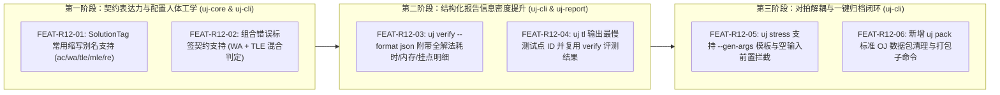

# Round 12 实战验题驱动演进计划（基于校赛 11 题全链路验题复盘）

> **生成时间**：2026-10-16  
> **背景来源**：使用 `uj` 完成校赛全部 11 道题目（T1 ~ T11，涵盖传统题、多组数据题、Special Judge 构造题、强制在线题、计算几何题与 `64MB` 极严卡空题，累计验证 90+ 份正交解法与 11000+ 次对拍）的端到端实战反馈。  
> **覆盖范围**：`uj-core`, `uj-cli`, `uj-report`  
> **架构准则**：严格遵守 [AGENTS.md](../../AGENTS.md) 四大硬性不变量（禁绝 `tokio`/async 运行时、结构化模式 `stdout` 零污染、禁止虚标沙盒隔离层级、Windows + Linux 双平台对等验证）。

---

## 一、 实战整体评估总结

在 11 道赛题的高强度验题流程中，`uj` 展现了极高的工程成熟度：
1. **AI-Native 结构化交互**：`validate`、`gen`、`judge`、`verify`、`stress`、`tl` 全链路 `--format json` 纯净输出，配合带行列号与修复提示（`hint`）的结构化错误（`ConfigError`、`VerifyMismatch`），使 Agent 能够零摩擦完成“评测 $\to$ 诊断 $\to$ 修复”闭环。
2. **声明式契约验证**：通过 `problem.toml` 的 `[[solutions]]` 将正交解法矩阵（主标程、副标程、不同方向 TLE、各类边界/溢出/贪心 WA）固化为可重复执行的自动化契约。
3. **Windows 沙盒度量精准度**：毫秒级耗时、KB 级工作集峰值内存（如在 `64MB` 限制下精确区分 CSR 静态数组 `7292KB` 与 `std::vector` 存图 `12712KB`）以及 NT 异常状态码（如捕获数组越界写触发的堆损坏 `0xC0000374`）均高度可靠。

与此同时，实战中也暴露出 5 项影响验题与出题闭环效率的工程痛点。本计划针对这 5 项痛点给出源码级改进方案。

---

## 二、 全局演进路线图 (Execution Roadmap)



---

## 三、 详细改进项与源码级实施规范

### 1. [FEAT-R12-01 | P1 High] `SolutionTag` 支持竞赛常用缩写别名（`ac` / `wa` / `tle` / `mle` / `re`）

- **实战痛点**：
  - 在配置 `problem.toml` 的 `[[solutions]]` 时，出题人与 Agent 极易按直觉写入 `tag = "ac"`、`tag = "wa"`、`tag = "tle"`，从而触发 `ConfigError: unknown variant 'ac', expected one of 'main', 'accepted', 'wrong_answer', ...`，造成不必要的往返修改。
- **问题代码定位**：
  - `crates/uj-core/src/config.rs`（`enum SolutionTag`，第 210–221 行）
- **拆分执行步骤**：
  - **Step 1.1**：在 `SolutionTag` 各枚举变体上添加 Serde 别名注解，保持序列化输出仍为规范全称，反序列化同时兼容全称与缩写：
    ```rust
    #[derive(Debug, Clone, Copy, PartialEq, Eq, Serialize, Deserialize, JsonSchema)]
    #[serde(rename_all = "snake_case")]
    pub enum SolutionTag {
        Main,
        #[serde(alias = "ac")]
        Accepted,
        #[serde(alias = "wa")]
        WrongAnswer,
        #[serde(alias = "tle")]
        TimeLimit,
        #[serde(alias = "mle")]
        MemoryLimit,
        #[serde(alias = "re")]
        RuntimeError,
        Rejected,
        Partial,
    }
    ```
  - **Step 1.2**：在 `crates/uj-core/src/config.rs` 单测中新增缩写解析测试，确保 `ac`、`wa`、`tle`、`mle`、`re` 均能无损解析为对应 `SolutionTag`。

---

### 2. [FEAT-R12-02 | P1 High] 支持混合错误判定契约（解决错解同时触发 `WA` 与 `TLE` 时的验证冲突）

- **实战痛点**：
  - 在强制在线题或图论题（如校赛 **T11** 的 `wa_no_range.cpp`）中，某份漏掉区间过滤的错解在小测试点上产生 `WA`（且由于答案错误导致后续异或解密参数 `lastans` 失真），而在高密度大图测试点上因为缺少区间剪枝触发了 `TLE`。
  - 现行 `check_solution_tag`（`crates/uj-cli/src/author_cmd.rs` 第 1307–1326 行）规定 `SolutionTag::WrongAnswer` **严禁出现任何 `TimeLimitExceeded`**（`has_fatal` 检查），否则直接报 `VerifyMismatch`。出题人只能被迫将其改为语义含糊的 `tag = "partial"` 或 `tag = "rejected"`，丢失了“该解法应当触发 WA（允许伴随 TLE）”的精确契约语义。
- **问题代码定位**：
  - `crates/uj-core/src/config.rs`（`SolutionTag`, `SolutionConfig`）
  - `crates/uj-cli/src/author_cmd.rs`（`check_solution_tag`，第 1293–1434 行）
- **拆分执行步骤**：
  - **Step 2.1**：在 `SolutionConfig` 中新增可选字段 `allow_verdicts: Option<Vec<Verdict>>`（或在 `SolutionTag` 中新增 `WrongAnswerOrTimeLimit` / `#[serde(alias = "wa_or_tle")]` 变体）。
  - **Step 2.2**：当配置了 `tag = "wa_or_tle"`（或 `allow_verdicts`）时，`check_solution_tag` 校验：
    1. 整体结论不得为 `Accepted` 或 `JudgeFailed`；
    2. 至少存在一个测试点为 `WrongAnswer`；
    3. 所有非 `Accepted` 测试点的判定均属于 `{WrongAnswer, TimeLimitExceeded}`，不得出现 `RuntimeError` 或 `JudgeFailed`。

---

### 3. [FEAT-R12-03 | P0 Critical] `uj verify --format json` 输出各解法的完整评测指标矩阵

- **实战痛点**：
  - 编写标准《验题报告》时，必须汇报每份正交解法的**实际判定、最大耗时（`max_time_ms`）、最慢测试点编号（`max_time_test`）、峰值内存（`max_memory_kb`）以及首次失败测试点编号（`first_fail_test`）**。
  - 目前 `run_verify_with_session`（`crates/uj-cli/src/author_cmd.rs` 第 1796–1866 行）在内存中明明已经持有所有解法的 `SubmissionJudgeReport`（`reports_by_sol_idx`），但在 `OutputFormat::Json` 模式下将其全部丢弃，仅输出：
    ```json
    { "ok": true, "verified": 14 }
    ```
  - 这迫使外部调用方在 `uj verify` 跑完一遍全量评测后，还要额外编写脚本对 14 份代码逐一重新执行 `uj judge <sol> -p . --format json`，耗时翻倍。
- **问题代码定位**：
  - `crates/uj-cli/src/author_cmd.rs`（`run_verify_with_session`，第 1769–1866 行）
- **拆分执行步骤**：
  - **Step 3.1**：在遍历 `cfg.solutions` 处理 `reports_by_sol_idx` 时，同步构建 `solutions_summary: Vec<serde_json::Value>`，每个元素包含：
    ```json
    {
      "path": "solutions/ac_secondary.cpp",
      "tag": "accepted",
      "matches_tag": true,
      "verdict": "AC",
      "score": 100.0,
      "max_time_ms": 765,
      "max_time_test": "36",
      "max_memory_kb": 7292,
      "first_fail_test": null,
      "first_fail_verdict": null
    }
    ```
  - **Step 3.2**：在 `OutputFormat::Json` 成功与失败返回体中均附带 `"solutions": solutions_summary` 字段，向后兼容原有的 `"ok"` 与 `"verified"` 字段。

---

### 4. [FEAT-R12-04 | P2 Medium] `uj tl` 报告最慢测试点 ID 并支持与 `uj verify` 共享评测结果

- **实战痛点**：
  - `uj tl --format json` 目前输出 `t_main_ms`、`t_slowest_ac_ms`、`peak_memory_kb`，但未指明峰值耗时与峰值内存分别发生在哪个测试点上。
- **问题代码定位**：
  - `crates/uj-cli/src/author_cmd.rs`（`run_tl_with_session`，第 1947–2176 行）
- **拆分执行步骤**：
  - **Step 4.1**：在统计 `t_main` 与 `t_slowest_ac` 时，同步记录对应的测试点 ID（`main_slowest_test`、`slowest_ac_test`、`peak_memory_test`）并写入 JSON 输出。

---

### 5. [FEAT-R12-05 | P1 High] `uj stress` 支持 `--gen-args` 参数模板、环境变量注入与空输入拦截

- **实战痛点**：
  - 许多出题人习惯将 `1..50` 号测试点的确定性构造逻辑写在同一个 `gen.cpp` 中，通过 `int test_id = atoi(argv[1]);` 分发测试点并在匹配后 `exit(0)`（如校赛 **T10**）。
  - 然而 `run_stress`（`crates/uj-cli/src/author_cmd.rs` 第 2403–2408 行）固定以 `vec![gen_bin, format!("{seed}")]` 调用生成器。当传入 `--seed 100` 时，`gen.cpp` 因未匹配 `1..50` 而直接返回 `0`，输出 0 字节的空文件，随后触发令人困惑的 Checker/Validator 报错：`Unexpected end of file - int32 expected`。
- **问题代码定位**：
  - `crates/uj-cli/src/cli.rs`（`Commands::Stress`）
  - `crates/uj-cli/src/author_cmd.rs`（`run_stress`，第 2402–2450 行）
  - `crates/uj-cli/src/mcp_server.rs`（`"stress"` 工具分支）
- **拆分执行步骤**：
  - **Step 5.1**：为 `uj stress` 新增可选参数 `--gen-args <TEMPLATE>`（默认值为 `"{seed}"`）。运行时将模板中的 `{seed}` 与 `{iter}` 替换为当前种子与迭代序号后按空白切分为 `argv`。
  - **Step 5.2**：在 `spec_gen.env` 中默认注入 `("UJ_STRESS", "1")`，方便单文件生成器感知当前处于随机对拍模式。
  - **Step 5.3**：在 `gen_res` 执行完毕后（第 2447 行），检查 `if in_bytes.is_empty()`。若生成器退出码为 0 但标准输出为空，立即中断并给出明确诊断：`"Generator produced empty stdout on seed {seed} (hint: check if gen.cpp ignores seeds outside fixed test IDs)"`。

---

### 6. [FEAT-R12-06 | P2 Medium] 新增 `uj pack` 标准数据包清理与导出子命令

- **实战痛点**：
  - 验题闭环的最后一步是将 `tests/*.in` 与 `tests/*.ans` 扁平打包为 `data.zip` 以供上传洛谷/Hydro 等 OJ。
  - 目前需要手动执行外部 `tar -a -c -f data.zip -C tests .`；且若出题中途调整过 `[[tests.gen]]` 数量，`tests/` 目录下极易残留过期的 `.in/.ans` 孤立文件并被误打包进 `data.zip`。
- **问题代码定位**：
  - `crates/uj-cli/src/cli.rs`
  - `crates/uj-cli/src/author_cmd.rs`
- **拆分执行步骤**：
  - **Step 6.1**：新增子命令 `uj pack -p . [-o data.zip] [--clean]`。
  - **Step 6.2**：调用 `discover_tests` 获取当前 `problem.toml` 合法测试点集合：
    - 校验每个 `.in` 是否均存在对应的 `.ans` 文件；
    - 若开启 `--clean`，自动清理 `tests/` 目录下不在 `discover_tests` 列表中的孤立文件；
    - 将所有合法的 `<id>.in` 与 `<id>.ans` 以扁平结构写入目标压缩包（`data.zip`），并在 `--format json` 下返回 `{"ok": true, "output": "data.zip", "test_count": 50, "size_bytes": ...}`。
