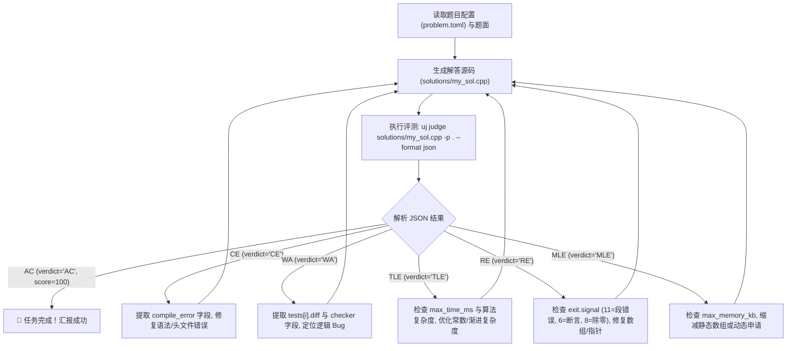

# uj AI Agent 详细使用与集成指南 (Agent Guide)

> 本文档面向与 `uj` 系统交互的 **AI 编程助手（AI Agents，如 Antigravity, Claude, Cursor, Copilot, 自主出题与解题智能体）**。
> 无论你是通过 **Model Context Protocol (MCP)** 还是通过 **CLI 命令行/子进程** 调度 `uj`，本文档均基于 `uj` 核心源码架构（`uj-core`, `uj-cli`, `uj-engine`, `uj-report`, `uj-sandbox`）提供最精确的调用规范、TOML 配置 Schema、数据流协议、经典出题/解题工作流及关键避坑防线。

---

## 1. Agent 视角下的交互定位与原则

`uj` 在设计之初就将 AI Agent 视为一等公民，具备以下关键特性：

1. **绝对标准输出（stdout）纯净度**：
   - 当指定 `--format json` 或 `--format ndjson` 时，标准输出（`stdout`）**绝不包含任何 ANSI 颜色代码、进度条、调试日志或警告文本**，只输出合法纯净的 JSON/NDJSON 载荷。
   - 所有调试告警（例如降级提示、编译输出、进度更新）一律写入 `stderr`。Agent 切勿使用 `2>&1` 将 stderr 混入 stdout，否则会破坏 JSON 反序列化。
2. **确定性退出状态码 (Exit Codes)**：
   - Agent 可根据进程退出码快速判定评测宏观结论：
     - `0` (`EXIT_SUCCESS`)：所有测试点均通过（AC），或命令执行成功。
     - `1` (`EXIT_NON_AC`)：评测完成，但存在测试点未通过（WA / TLE / MLE / RE / OLE / RF / PE）。
     - `2` (`EXIT_USAGE_OR_CONFIG`)：命令行参数错误、测试用例未找到或 `problem.toml` 语法非法。
     - `3` (`EXIT_JUDGE_FAILED`)：评测系统异常（校验器/交互器崩溃、沙盒报错等）。
     - `4` (`EXIT_VERIFY_MISMATCH`)：`uj verify` 阶段解法的实际评测结果与声明的期望标签不符。
     - `5` (`EXIT_COMPILE_ERROR`)：选手源码或辅助评测程序编译失败。
     - `130` (`EXIT_INTERRUPTED`)：被 SIGINT / Ctrl-C 中断。
3. **机器可读的 JSON Schema 支持**：
   - 任何时刻均可运行 `uj schema result`、`uj schema config`、`uj schema events` 导出标准的 JSON Schema 定义文件，用于类型校验与代码生成。

---

## 2. 两种集成模式：MCP 还是 CLI？

### 2.1 模式 A：MCP (Model Context Protocol) 服务模式（推荐）

通过标准 stdio JSON-RPC 2.0 协议连接 `uj mcp`。LLM 可直接将其作为工具（Tools）调用。

#### 客户端配置示例 (Claude Desktop / Roo Code / Antigravity)
```json
{
  "mcpServers": {
    "uj": {
      "command": "uj",
      "args": ["mcp"]
    }
  }
}
```

#### MCP 对外暴露的核心工具列表 (Tool Call Catalog)

MCP 暴露的工具与参数签名严格映射源码 `crates/uj-cli/src/mcp_server.rs`：

| 工具名称 (Tool Name) | 参数 (Arguments) | 说明 |
|---|---|---|
| `judge` | `{ "submission": "solutions/std.cpp", "problem": ".", "sources": ["..."] }` | 评测单份或多份选手源码，返回评测结构体 |
| `build` | `{ "problem": ".", "targets": [] }` | 编译题目下的所有组件（Checker、Validator、标程等） |
| `pipeline` | `{ "problem": "." }` | 一键执行自动化出题流水线（build ➡️ gen ➡️ validate ➡️ ans ➡️ verify ➡️ tl） |
| `stress` | `{ "problem": ".", "generator": "gen.cpp", "solution": "solutions/wa.cpp", "brute": "solutions/brute.cpp", "count": 100 }` | 自动化差分对拍找反例 |
| `verify` | `{ "problem": "." }` | 批量验证 `problem.toml` 中声明的所有期望解法 |
| `doctor` | `{ "problem": boolean }` | 诊断宿主沙盒与当前题目数据健康度 |
| `show` | `{ "problem": ".", "run_id": "", "test": "1" }` | 深度检查某次运行或某个具体测试点的输入输出差异 |
| `contest` | `{ "dir": "contest_root" }` | 批量评测整场多题多选手的比赛包 |

> ⚠️ **注意**：`uj init` 目前是 CLI 独有命令（`uj init <dir> --type traditional`），尚未纳入 MCP 工具集。创建题目目录骨架建议直接使用 CLI。

---

### 2.2 模式 B：CLI 子进程执行模式

若在终端或通过代码子进程（`subprocess` / `Command`）直接调用，可使用 `--format json` 或 `--format ndjson`：

```bash
# 评测单个解法并输出纯 JSON
uj judge solutions/std.cpp -p . --format json

# 评测解法并开启 fail-fast（遇到首个错点立即停机）
uj judge solutions/std.cpp -p . --format json --fail-fast

# 一键运行出题流水线
uj pipeline -p . --format json

# 自动化对拍
uj stress -p . --gen gen.cpp --sol solutions/wa.cpp --brute solutions/brute.cpp -n 1000 --format json
```

#### 全局通用 CLI 参数表 (Global Flags)
- `-p, --problem <DIR>`：指定包含 `problem.toml` 的题目根目录（默认 `.`）。
- `--format <human|json|ndjson>`：输出格式。交互终端默认 `human`，非 TTY 环境默认 `json`。
- `-j, --jobs <N>`：并行评测/编译槽位数（默认自动检测物理核心数）。
- `--sandbox <auto|full|degraded|none>`：沙盒隔离等级（默认 `auto`）。
- `--require-tier`：要求必须达到 Full 隔离层级，否则直接中止。
- `--no-cache`：禁用编译二进制与输出答案的 Blake3 缓存，强制重跑。
- `--fail-fast`：某个测试点未通过时立即终止当前子任务剩余测试点。

---

## 3. 标准题目规范与 `problem.toml` 配置全解 (Source-Level Spec)

根据 `crates/uj-core/src/config.rs` 源码定义，`problem.toml` 是题目的核心配置文件。

### 3.1 核心配置范例 (A+B / 区间和范例)

```toml
schema = 1
name = "interval_sum"
type = "traditional"

[limits]
time = "1.0s"
memory = "256MB"
stack = "same"
output = "64MiB"

[io]
mode = "stdio"

[checker]
type = "builtin"
name = "wcmp"

validator = "validator.cpp"

[tests]
dir = "tests"
pattern = "auto"

[[tests.gen]]
generator = "gen.cpp"
args = "100 100"
count = 3
subtask = 1

[[tests.gen]]
generator = "gen.cpp"
args = "100000 100000"
count = 5
subtask = 2

[[subtasks]]
id = 1
score = 30.0
scoring = "min"
tests = ["1-3"]

[[subtasks]]
id = 2
score = 70.0
scoring = "min"
tests = ["4-8"]
depends = [1]

[[solutions]]
path = "solutions/std.cpp"
tag = "main"

[[solutions]]
path = "solutions/brute.cpp"
tag = "time_limit"

[[solutions]]
path = "solutions/wrong_greedy.cpp"
tag = "wrong_answer"
```

### 3.2 字段语法与类型严密约束表

| 字段位置 | 字段名 | 类型 | 默认值 | 严格规范与合法值 |
|---|---|---|---|---|
| **根目录** | `schema` | `u32` | `1` | Schema 版本号 |
| **根目录** | `name` | `string` | **必填** | **必须为顶层字段！严禁加 `[problem]` 表头**。题目代号标识符 |
| **根目录** | `type` | `enum` | `"traditional"` | `"traditional"`, `"interactive"`, `"grader"`, `"communication"`, `"output_only"` |
| **根目录** | `validator` | `path` | `None` | 输入校验器路径（如 `"validator.cpp"`） |
| **根目录** | `interactor` | `path` | `None` | 交互题交互器路径（如 `"interactor.cpp"`） |
| **根目录** | `manager` | `path` | `None` | 通信题评测管理器（如 `"manager.cpp"`） |
| **根目录** | `processes` | `usize` | `1` | 通信题参赛选手进程数量 |
| **根目录** | `communication_topology` | `string` | `None` | 当 `processes > 1` 时必填支持的拓扑结构（如 `"ring"` 或 `"pipeline"`） |
| `[limits]` | `time` | `string` | **必填** | **带单位字符串**。如 `"1s"`, `"1.0s"`, `"500ms"`（底层由 `parse_time_ms` 解析） |
| `[limits]` | `memory` | `string` | **必填** | **带单位字符串**。如 `"256MB"`, `"512MiB"`, `"1GiB"`（底层由 `parse_bytes` 解析） |
| `[limits]` | `stack` | `string` | `"same"` | 栈空间限制。合法值：`"same"`, `"unlimited"`, 或带单位如 `"256MiB"` |
| `[limits]` | `output` | `string` | `"64MiB"` | 允许的标准输出最大字节数 |
| `[io]` | `mode` | `enum` | `"stdio"` | `"stdio"` 或 `"file"` |
| `[io]` | `input` / `output` | `string` | `None` | 文件 IO 模式下的文件名（如 `"sum.in"`, `"sum.out"`） |
| `[checker]` | `type` | `enum` | `"builtin"` | `"builtin"`, `"testlib"`, `"lemon"` |
| `[checker]` | `name` | `string` | `None` | 当 `type="builtin"` 时有效。合法值：`"exact"`, `"wcmp"`, `"fcmp"`, `"lcmp"`, `"ncmp"`, `"hcmp"`, `"rcmp4"`, `"rcmp6"`, `"rcmp9"`, `"yesno"` |
| `[checker]` | `path` | `path` | `None` | 当 `type="testlib"` 时指定自定义校验器源码（如 `"checker.cpp"`） |
| `[checker]` | `pe_as_wa` | `bool` | `true` | 是否将格式错误视为 WA |
| `[tests]` | `dir` | `path` | `"tests"` | 测试数据存放目录（**默认是 `tests`，不是 `data`**） |
| `[tests]` | `pattern` | `string` | `"auto"` | 输入文件识别模式（默认识别 `*.in`） |
| `[[tests.gen]]` | `generator` | `string` | **必填** | 生成器源码或程序路径（如 `"gen.cpp"`） |
| `[[tests.gen]]` | `args` | `string` | `""` | **单个字符串，参数以空格隔开**（如 `"100 100"`，**严禁使用数组**） |
| `[[tests.gen]]` | `count` | `usize` | `1` | 调用生成器生成的用例数量。若 `count > 1`，系统会自动追加序号 `1..N` 作为末尾参数 |
| `[[tests.gen]]` | `subtask` | `u32` | `None` | 关联的子任务编号（可选） |
| `[[subtasks]]` | `id` | `u32` | **必填** | 子任务 ID（正整数，如 `1`） |
| `[[subtasks]]` | `score` | `f64` | **必填** | 分值（总分通常为 100.0） |
| `[[subtasks]]` | `scoring` | `enum` | `"min"` | 打分方式：`"min"`（子任务取最小分）或 `"sum"`（按测试点平均累计） |
| `[[subtasks]]` | `tests` | `[string]` | `[]` | **测试点匹配规则列表**。支持：区间 `"1-10"`、Glob `"sample*"`、正则 `"re:^edge_"`、精确 `"1"` |
| `[[subtasks]]` | `depends` | `[u32]` | `[]` | **依赖的子任务 ID 列表**（**字段名是 `depends`，不是 `dependencies`**） |
| `[[solutions]]` | `path` | `path` | **必填** | 解法源码路径（**字段名是 `path`，不是 `source`**） |
| `[[solutions]]` | `tag` | `enum` | **必填** | 预期行为标签（**字段名是 `tag`，不是 `expect`**）。合法值见下文 |
| `[[solutions]]` | `expect_subtasks` | `map` | `None` | 子任务级别的精确预期，如 `{ 1 = "AC", 2 = "TLE" }` |

#### SolutionTag 合法枚举值
- `"main"`：官方主标程（要求必须所有测试点 Accepted，`uj ans` 优先选用此解法生成 `.ans`）。
- `"accepted"`：其他备选标程/常数不同的正解（要求全部 Accepted）。
- `"wrong_answer"`：预期 WA 解（必须至少出现一次 WA，且**不得**发生 TLE/MLE/RE 等崩溃）。
- `"time_limit"`：预期超时暴力解（必须至少出现一次 TLE，且**不得**发生 WA/MLE/RE 等）。
- `"memory_limit"`：预期爆内存解（必须至少出现一次 MLE，且不得发生 WA/TLE/RE）。
- `"runtime_error"`：预期崩溃解（必须至少出现一次 RE，且不得发生 WA/TLE/MLE）。
- `"rejected"`：预期被拒（最终结论只要不是 AC 即可）。
- `"partial"`：部分分算法（得分必须严格满足 `0 < score < 100`）。

---

## 4. 目录结构规范与四大高频避坑防线 (Critical Gotchas)

### 4.1 `uj init` 生成的真实目录结构
运行 `uj init <dir> --type traditional` 后，系统会自动生成标准骨架：

```
my_problem/
├── problem.toml           # 核心元数据配置
├── statement.md           # 题面描述文件（注意是 statement.md，不是 problem.md！）
├── testlib.h              # 官方内嵌释放的 testlib.h
├── gen.cpp                # 默认随机数据生成器（位于根目录）
├── validator.cpp          # 默认数据校验器（位于根目录）
├── solutions/             # 官方解法目录
│   ├── std.cpp            # 主标程 (tag: main)
│   ├── brute.cpp          # 暴力解 (tag: accepted)
│   └── wrong.cpp          # 错误解 (tag: wrong_answer)
└── tests/                 # 测试数据目录（注意是 tests/，不是 data/！）
    ├── 1.in               # ⚠️ 危险默认数据（内容为 "1 2\n"）
    └── 1.ans              # ⚠️ 危险默认数据（内容为 "3\n"）
```

---

### 4.2 避坑防线 1：`tests/1.in` 脏数据与 `ExitStatus::Signaled(11)` 陷阱（极度致命！）

- **现象**：在完成新题编写并运行 `uj pipeline` 时，标程在测试点 `1` 上发生 `ExitStatus::Signaled(11)`（即 Linux 的 `SIGSEGV` 段错误崩溃）。
- **根本原因**：
  1. `uj init` 在初始化时默认写入了 A+B 题目的样例数据 `tests/1.in`（内容仅为 `"1 2\n"`）。
  2. `uj gen` 的实现逻辑是：扫描 `tests/` 目录下现有的纯数字 `.in` 文件，取得最大编号 `max_idx`，然后从 `max_idx + 1` 开始递增生成新测试点。
  3. 因此，**原本的 `tests/1.in` 不会被生成器覆盖，而是原样保留**！
  4. 如果当前题目需要读取数组、树或复杂图结构，标程读取 `1.in` 时会瞬间读到 `EOF`，导致未初始化内存访问或非法下标越界，在沙盒严密保护下被系统内核处以 `SIGSEGV` 处决！
- **Agent 标准处置动作**：
  在配置完成 `problem.toml` 后、运行 `uj pipeline` 或 `uj gen` 之前，**必须首先清空或删除 `tests/` 目录下的脏数据**：
  ```bash
  rm -rf tests/*
  # 或在 Windows PowerShell:
  Remove-Item tests/* -Force
  ```

---

### 4.3 避坑防线 2：`testlib.h` 头文件寻找机制与源码放置规范

- **底层机制**：`crates/uj-engine/src/compiler.rs` 在编译生成器、验证器或标程时，默认直接调用 `g++ -std=c++17 -O2 ...`，**未向编译器隐式注入 `-I.`**（除非是特定 Grader 题型）。GCC 的默认行为只会在被编译源码文件的同级目录下查找 `#include "testlib.h"`。
- **最佳规范**：
  - **规范做法（推荐）**：直接沿用 `uj init` 结构，将 `gen.cpp` 与 `validator.cpp` 保存在题目根目录下（与 `testlib.h` 位于同级），使用 `#include "testlib.h"`。
  - **子目录做法**：若将生成器放在 `generators/gen.cpp`，源码中必须写：
    ```cpp
    #include "../testlib.h"
    ```
    或者在 `generators/` 目录下放一份 `testlib.h` 副本，否则编译必然报错 `fatal error: testlib.h: No such file or directory`。

---

### 4.4 避坑防线 3：`[[tests.gen]]` 参数解析与批次生成规则

- `args` 必须是**单行字符串**，`uj gen` 在内部使用 `.split_whitespace()` 将其切割为命令行实参。
- 当 `count > 1` 时，`uj gen` 会在切分后的 `args` 参数末尾**自动额外传递一个当前用例的顺序号**（从 `1` 到 `count`，作为 `argc` 的最后一项）。
- **生成器编写最佳范式**：
  ```cpp
  #include "testlib.h"
  using namespace std;

  int main(int argc, char* argv[]) {
      registerGen(argc, argv, 1);
      int n = atoi(argv[1]);
      int q = atoi(argv[2]);
      // 若 count > 1，argv[3] 为当前测试用例的批次索引 (1, 2, 3...)
      // testlib 内置的 rnd 会自动结合命令行参数产生唯一稳定伪随机种子
      ...
  }
  ```

---

### 4.5 避坑防线 4：Windows Defender 扫描与沙盒冷启动抖动

- 在 Windows 宿主环境下，GCC 刚刚编译生成的可执行二进制文件首次被沙盒（AppContainer / Job Object）拉起时，Windows Defender 往往会同步阻滞扫描 3~7 秒。
- `uj` 内置了 Defender 迟滞自适应检测机制：若发现程序触发 Wall Limit 且实际 CPU 时间极小（`< 10% TL`），会自动重跑。但在编写高精度时限题目时，建议在 WSL2 / Linux 生产环境中进行终审评测（`wsl uj pipeline`）。

---

## 5. Agent 核心任务实战工作流 (Action Recipes)

### 场景一：解题 Agent（编写解法、自动化评测与循环自愈）



#### 解题评测 JSON 解析范式 (Python 完整实现)
```python
import json
import subprocess
from typing import Dict, Any

def judge_submission(solution_path: str, problem_dir: str = ".") -> Dict[str, Any]:
    cmd = ["uj", "judge", solution_path, "-p", problem_dir, "--format", "json"]
    proc = subprocess.run(cmd, stdout=subprocess.PIPE, stderr=subprocess.PIPE, text=True)
    
    # 标准输出为严格纯净的 JSON
    try:
        report = json.loads(proc.stdout)
    except json.JSONDecodeError as e:
        return {"status": "SE", "error": f"JSON parse error: {e}, stderr: {proc.stderr}"}

    verdict = report.get("verdict")
    score = report.get("score", 0.0)

    # 1. 编译错误 (CE) 的真实字段是 compile_error
    if verdict == "CE":
        return {
            "status": "CE",
            "compile_error": report.get("compile_error", "")
        }

    # 2. 系统异常 (SE)
    if verdict == "SE":
        return {
            "status": "SE",
            "error": report.get("judge_failed_error", "Unknown system failure")
        }

    # 3. 正常评测结果分析
    if verdict == "AC":
        return {
            "status": "AC",
            "score": score,
            "max_time_ms": report.get("max_time_ms"),
            "max_memory_kb": report.get("max_memory_kb")
        }

    # 4. 未通过：从扁平的 tests 列表中收集未通过的点
    failed_tests = []
    for t in report.get("tests", []):
        if t.get("verdict") != "AC":
            failed_tests.append({
                "test_id": t.get("id"),
                "subtask": t.get("subtask"),
                "verdict": t.get("verdict"),
                "time_ms": t.get("time_ms"),
                "memory_kb": t.get("memory_kb"),
                "exit": t.get("exit", {}),
                "checker": t.get("checker"),
                "diff": t.get("diff")
            })

    return {
        "status": verdict,
        "score": score,
        "max_time_ms": report.get("max_time_ms"),
        "max_memory_kb": report.get("max_memory_kb"),
        "failed_tests": failed_tests
    }
```

---

### 场景二：出题 Agent（从零端到端命制新题）

完整规范出题循环：

#### 步骤 1：创建骨架并清理脏数据
```bash
uj init my_problem --type traditional
cd my_problem

# 极其关键：必须清除默认的 A+B 脏样例！
rm -rf tests/*
```

#### 步骤 2：撰写题面与核心逻辑
- 题面文件：编辑 `statement.md`。
- 比较器：在 `problem.toml` 中配置 `[checker]` 为内置的 `wcmp` / `exact`，或者编写 `checker.cpp`。
- 校验器：编写 `validator.cpp`（遵循 testlib 规范）。
- 官方标程：编写 `solutions/std.cpp`（在 `problem.toml` 中标记为 `tag = "main"`）。
- 对抗/扰乱解法：编写 `solutions/brute.cpp`（暴力，tag: `time_limit`）与 `solutions/wrong.cpp`（贪心错解，tag: `wrong_answer`）。
- 生成器：编写 `gen.cpp`。

#### 步骤 3：配置 `problem.toml`
参考本文档第 3 节的语法表，配置各子任务依赖与数据生成参数。

#### 步骤 4：一键流水线构建与验证
```bash
uj pipeline -p . --format json
```
流水线在底层顺序执行：
1. `uj build`：编译 `validator.cpp`, `gen.cpp`, 以及 `solutions/` 下的所有源码。
2. `uj gen`：执行 `[[tests.gen]]` 生成所有输入用例。
3. `uj validate`：使用 `validator.cpp` 校验生成的输入文件，若格式非法直接中断。
4. `uj ans`：调用 `tag="main"` 的标程生成对应的 `.ans` 答案文件。
5. `uj verify`：用生成的完整测试集评测 `solutions/` 下声明的所有解法，若某解法实际评测表现与声明的 `tag`（如标程未 AC、暴力解未 TLE）不符，立即报错 `EXIT_VERIFY_MISMATCH`（退出码 4）。
6. `uj tl`：评测并计算标程和备选解法的耗时峰值，输出推荐时限。

#### 步骤 5：自动写入推荐时限
```bash
uj tl -p . --apply
```
自动将推荐的科学时限写回 `problem.toml` 的 `[limits.time]` 字段。

---

### 场景三：对抗调试 Agent（自动对拍挖掘反例）

当选手程序遇到玄学 WA 或边界 Bug，人类与 Agent 很难肉眼找出反例时，使用 `uj stress` 进行自动化差分对拍：

```bash
uj stress \
  -p . \
  --gen gen.cpp \
  --sol solutions/my_wa_solution.cpp \
  --brute solutions/brute_force.cpp \
  -n 1000 \
  --time-budget 60s \
  --format json
```

#### 对拍分歧与反例捕获
当对拍检测到分歧时，进程退出码为 `1`，返回如下格式的纯净 JSON：
```json
{
  "ok": false,
  "seed": 142,
  "diff": "wrong answer 1st numbers differ - expected: '15', found: '14'",
  "saved_to": "stress"
}
```
并且系统会**自动将最小反例与双方输出持久化写入 `stress/` 目录**：
- `stress/fail-142.in`：触发分歧的具体输入数据。
- `stress/fail-142.sol.out`：被测程序的错误输出。
- `stress/fail-142.brute.out`：暴力对拍程序的正确基准输出。

Agent 只需直接读取 `stress/fail-142.in` 文件，即可立即进入断点单步调试或编写边界单元测试！

若 1000 次对拍全部一致，返回：
```json
{
  "ok": true,
  "iterations": 1000,
  "duration_ms": 1425
}
```

---

## 6. 评测结果核心数据结构速查 (Field Guide)

### 6.1 `SubmissionJudgeReport` JSON 结构
当执行 `uj judge ... --format json` 时，输出的根对象字段严格对应 `crates/uj-report/src/result.rs`：

```json
{
  "schema_version": 1,
  "problem": "interval_sum",
  "submission": "std.cpp",
  "verdict": "AC",
  "score": 100.0,
  "max_time_ms": 120,
  "max_memory_kb": 14200,
  "subtasks": [
    {
      "id": 1,
      "score": 30.0,
      "max_score": 30.0,
      "verdict": "AC",
      "test_ids": ["1", "2", "3"]
    },
    {
      "id": 2,
      "score": 70.0,
      "max_score": 70.0,
      "verdict": "AC",
      "test_ids": ["4", "5", "6", "7", "8"]
    }
  ],
  "tests": [
    {
      "id": "1",
      "subtask": 1,
      "verdict": "AC",
      "score": 10.0,
      "time_ms": 45,
      "wall_ms": 52,
      "memory_kb": 12800,
      "exit": { "code": 0, "signal": null, "nt_status": null },
      "checker": "ok",
      "diff": null,
      "timing": {
        "rejudged": false,
        "confidence": "Normal",
        "samples_ms": [45]
      },
      "sandbox_tier": "Full"
    }
  ]
}
```

### 6.2 信号（Signal）与崩溃诊断对照表

若测试点结论为 `RE`（Runtime Error），查看 `exit.signal` 字段以判断具体的崩溃类型：

| 信号值 (`signal`) | POSIX 宏 | 典型成因 | Agent 应对策略 |
|---|---|---|---|
| `11` | `SIGSEGV` | 数组下标越界、解引用空指针、递归爆栈、或**读入数据不足提前遭遇 EOF** | 检查数组上限、递归边界；改用动态内存或增大声明大小；**务必检查 `tests/1.in` 是否为未清除的脏数据** |
| `6` | `SIGABRT` | `assert(...)` 断言失败、C++ `std::terminate` 抛出未捕获异常 | 检查数据范围是否超出题目约定，排查边界断言与异常捕获 |
| `8` | `SIGFPE` | 整数除以零、浮点非法异常、模 0 (`% 0`) | 检查除数与模数变量是否可能在特定边界下为 0 |
| `24` | `SIGXCPU` | CPU 运算超时 | 算法时间复杂度过高，重写核心算法 |
| `25` | `SIGXFSZ` | 输出内容超出限额（`OutputLimit`） | 陷入死循环打印、或输出了海量调试日志 |

---

## 7. Agent 提效与 Token 优化最佳实践 (Best Practices)

1. **先探测再评测（Fail-Fast 策略）**：
   - 调试大规模数据集题目时，务必附加 `--fail-fast`：
     ```bash
     uj judge solution.cpp -p . --format json --fail-fast
     ```
     只要某个测试点未通过，当前子任务立即熔断停机，不仅节约 CPU 周期，更大幅减少返回给 LLM 的 JSON 上下文 Token。
2. **单测试点精准复查 (`uj show`)**：
   - 当题目测试点达到成百上千个时，不要每次都通读完整评测包，可通过：
     ```bash
     uj show --test 1 -p . --format json
     ```
     仅回传错误测试点的详细输入输出差异与校验器报错。
3. **禁用缓存调试 (`--no-cache`)**：
   - 当修改了头文件（如自定义的库文件、模板）或者重新编译时，加上 `--no-cache` 强行重编译和重评测。
4. **沙盒降级感知与环境自适应**：
   - 在未配置完整 cgroup v2 委派的轻量容器、无特权 Docker 或 WSL 环境中，`uj` 会自动降级为 `Tier::Degraded`（保留 namespace 与 seccomp 隔离，使用 POSIX rlimit 进行防护）。
   - Agent 自动化调度时，无需强求 `Full` 层级，直接采用默认 `--sandbox auto` 即可平滑适配任何宿主环境。
